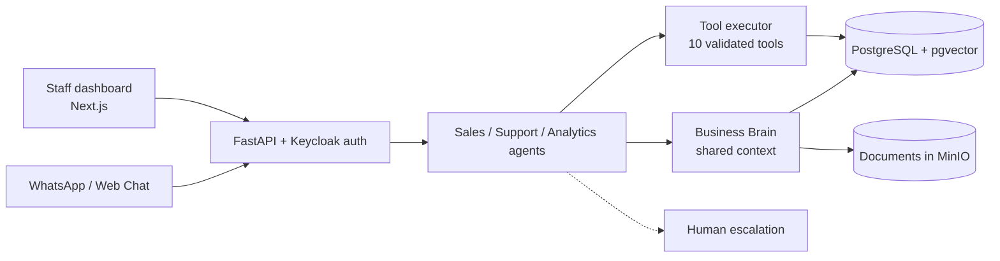

# Multi-Agent Platform for SMEs

An intelligent adaptive multi-agent platform that automates customer conversations and business analytics for small and medium-sized retail businesses.

## What it does

- **Answers customers.** Sales, Support and Analytics agents reply to customer messages using the shop's real catalog, stock, orders and policies.
- **Acts safely.** Agents only *propose* actions. A trusted executor checks permissions and business rules, then runs one of ten business tools (find a product, check stock, create an order, reserve stock…). Writes need explicit customer confirmation.
- **Hands off to people.** Anything the agents cannot settle with verified facts goes to a human operator, with the full context attached.
- **Gives staff one workspace.** Inbox, escalations, customers, orders, products, inventory, knowledge base and sales analytics.

**Research question:** does *context-aware adaptive* multi-agent orchestration outperform a single agent and a static multi-agent setup under the same conditions? See [PRD §9](docs/PRD.md#9-research-requirements-and-success-measures).

## Architecture



Details: [Architecture](docs/ARCHITECTURE.md) · [UML diagrams](docs/uml/README.md)

| Layer | Technology |
| --- | --- |
| Backend | Python 3.12, FastAPI, Pydantic, SQLAlchemy, Alembic |
| Data | PostgreSQL with pgvector and row-level security, Redis, MinIO |
| Identity | Keycloak (OIDC, PKCE) |
| LLM | Claude or Gemini via API; Ollama for local experiments |
| Frontend | Next.js 16, React 19, TypeScript, Tailwind CSS 4 |
| Infrastructure | Docker Compose |

## Repository layout

```
platform/   Backend service, database migrations, Docker Compose, tests
frontend/   Staff dashboard and customer web chat (Next.js)
docs/       Product, architecture, design and UX research documents, UML diagrams
research/   Consolidated master document (PDF)
```

## Getting started

Requirements: Docker, Python 3.12, Node.js 24.

```bash
# Backend
cd platform
cp .env.example .env          # replace every CHANGE_ME_* value
docker compose -f infra/compose/compose.yaml --env-file .env up -d --wait
curl http://127.0.0.1:8000/health/ready

# Frontend
cd ../frontend
npm ci
cp .env.example .env.local
npm run dev                   # http://127.0.0.1:3000
```

More: [backend guide](platform/README.md) · [frontend guide](frontend/README.md) · [WhatsApp demo](docs/WHATSAPP_DEMO.md)

## Status

| Area | Status |
| --- | --- |
| Data model, tenant isolation, business tools, identity | ✅ Done, covered by automated tests |
| Business Brain and document retrieval (RAG) | ✅ Done, covered by automated tests |
| Sales, Support and Analytics agents | ✅ Implemented · ⏳ acceptance with a live LLM pending |
| Staff dashboard | ✅ All screens · live data for sign-in, products, inventory, customer and order details, sales analytics and inbox; other screens use sample data |
| WhatsApp channel | ✅ Demo, answered by Claude |
| Single / Static / Adaptive orchestration variants | ⬜ Not started |
| Resuming a case after a human decision | ⬜ Designed, not built |
| Sales forecasting model | ⬜ Not started — forecasts return "model not ready" |
| Instagram, Telegram, web chat transport | ⬜ Not started |

Known limitation: changing an existing order (`update_order`) is blocked by policy and routed to a person.

## Documentation

| Document | Contents |
| --- | --- |
| [PRD](docs/PRD.md) | Product scope, users, requirements, research measures |
| [Architecture](docs/ARCHITECTURE.md) | Layers, agents, Business Brain, tools, runtime flows |
| [Design](docs/DESIGN.md) | UX/UI contract for every screen |
| [Development rules](docs/RULES.md) | Engineering, security and research rules |
| [WhatsApp demo](docs/WHATSAPP_DEMO.md) | Step-by-step demo setup |
| [UX research](docs/research/) | Competitor analysis, information architecture, user flows, design system |
| [UML](docs/uml/README.md) | All 14 UML 2.5 diagram types plus ER diagrams |
| [Ollama experiment](docs/experiments/OLLAMA_LOCAL_EXPERIMENT.md) | Running the agents on a local model |
| [Master document](research/master/release/FINAL_MASTER_DEVELOPMENT_SAFE.pdf) | Consolidated project specification |

Visual design: [Figma — Multi-Agent Platform UI](https://www.figma.com/design/W6XefZbbmZq1YZltBfsry7) (clickable desktop, tablet and mobile prototype).

## License

[MIT](LICENSE)
