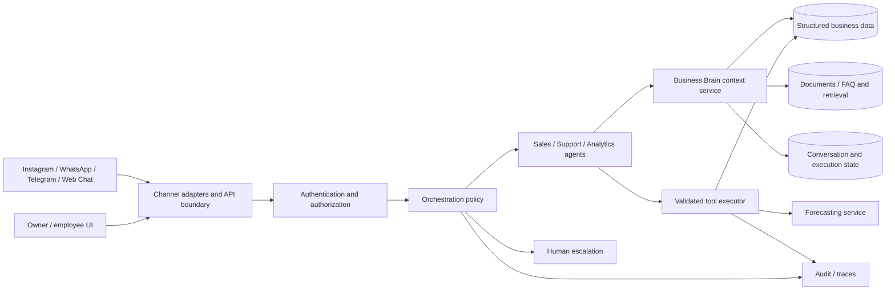
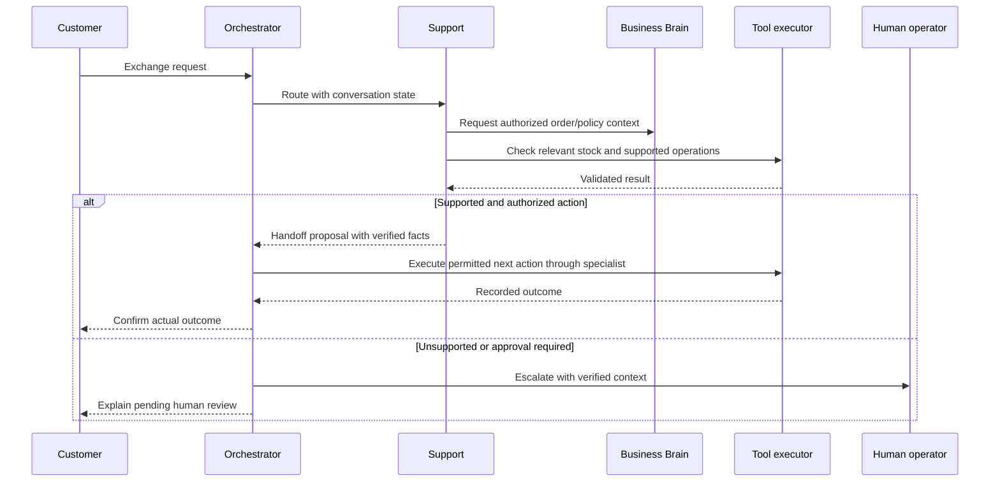

# System Architecture

## 1. Status and principles

This document describes the MVP architecture. The backend core (data, tenant isolation, business tools, identity, Business Brain, document retrieval), the specialist agents, the staff frontend and a WhatsApp demo channel are implemented. The three research orchestration variants and the forecasting model are not built yet. Current status is in the [README](../README.md#status); product scope lives in [PRD.md](PRD.md).

Architectural rules: put authorization and business invariants in deterministic application services; give agents only relevant context and permitted tools; use structured sources for operational facts and RAG for unstructured knowledge; preserve context and provenance across handoffs; keep research variants comparable; prefer an implementable modular MVP.

## 2. High-level architecture

The diagram names responsibilities, not separately deployed services. The channel adapters normalize external events; the API boundary authenticates requests and associates them with the correct business context. The orchestrator selects permitted next steps. Agents generate task reasoning and tool proposals. The executor independently checks authorization, validated inputs, business rules, and state before performing a tool call.

## 3. Layers and project baseline technology

| Layer | Responsibility | Technology |
| --- | --- | --- |
| Client channels | Message transport and normalization for target channels | Channel adapters plus Web Chat; external API feasibility TBD |
| API and security | Staff authentication, request validation, permissions, API contracts | Python/FastAPI/Pydantic; Keycloak with OAuth2/OIDC/JWT and RBAC |
| Orchestration | Route, continue, hand off, clarify, escalate, persist execution state | LangGraph (planned); the adaptive policy is a research target |
| Agents | Bounded Sales, Support, Analytics behavior | Claude and Gemini via API; Ollama for local experiments |
| Business Brain | Authorized structured context, documents, history, rules, tool registry | PostgreSQL, pgvector, Redis, MinIO/S3 |
| Tools and business operations | Validated reads/writes, reports, forecast requests | Application services and explicit tool contracts |
| Data and operations | Durable records, object storage, local runtime, telemetry | PostgreSQL, Docker, Docker Compose |

The frontend uses Next.js, React and TypeScript and reads data through a typed service/API layer; screens and navigation are specified in [DESIGN.md](DESIGN.md). The planned forecasting stack is pandas, scikit-learn and XGBoost. The backend is a modular monolith — thin API routers, separate orchestration and agent policy, authoritative business services — not a set of microservices. Kafka/NATS, ClickHouse, Kubernetes, event sourcing and CQRS are out of scope for the MVP.

## 4. Identity and authorization

Staff roles and tenant/resource ownership must be enforced at the API and tool executor. An agent's selected role cannot expand the current principal's permissions. Customer identity verification is required before disclosing private order/customer details; the exact process is TBD. Credentials remain outside prompts and logs. Human approval, where required by business policy, is a separate gate from model confidence. Authorization applies equally to all three research architectures.

## 5. Agent model and orchestration

An agent is defined by its role, responsibility, goal, allowed tools, access constraints, and relevant Business Brain context. Sales owns supported catalog/purchase flows; Support owns order help and policies; Analytics owns authorized reports/forecasts. The agent roster is fixed for the MVP concept, while exact prompts, tool permissions, and handoff rules remain open.

The adaptive policy may consider intent, available facts, conversation and execution state, tool availability, task complexity, permissions, and confidence. It may continue the current agent, clarify, call an authorized tool, hand off, escalate, or finish. Confidence semantics and thresholds must be specified before writes or evaluation; they are not invented here. A human handoff carries verified facts, sources, outstanding questions, attempted actions, and the reason for escalation. The precise adaptive decision algorithm is a **RESEARCH TARGET**.

## 6. Business Brain

| Context type | Intended source and access |
| --- | --- |
| Structured facts | Authorized APIs/SQL/tools for customers, products, orders, inventory, sales, transactions where available. |
| Unstructured knowledge | Versioned company documents, FAQ, policies, instructions, and descriptions; retrieval/RAG when relevant. |
| State and history | Conversation, current task and execution state, prior tool outcomes, business events. |
| Rules and capabilities | Applicable business rules and the tool registry with permissions and contracts. |

The Business Brain is a context boundary, not a second database or a synonym for vector search. Structured facts remain authoritative in their business stores. Retrieved documents require provenance and permission checks. Sources that disagree should be surfaced as uncertainty; the model must not silently choose a convenient version.

## 7. Tool execution and data

The tool registry is fixed at ten operations (see [PRD.md](PRD.md#4-core-concepts)). Each tool has a typed input/output contract, permission rule, validated resource scope, business preconditions, error result and audit event (`platform_backend/tools/`). Writes additionally define state-transition, duplicate/retry and uncertain-outcome (`OUTCOME_UNKNOWN`) behavior. Agents request actions; deterministic services decide whether they may run. The physical schema is defined by the Alembic migrations in `platform/infra/migrations/`.

Operational records preserve customer, product, order, inventory, sales and conversation relationships. PostgreSQL row-level security isolates tenants, pgvector stores document embeddings and MinIO holds uploaded documents. Data retention, backups and a production migration strategy require later decisions.

## 8. Analytics and ML

The MVP includes reports and a sales forecasting module. Candidate model progression: naive baseline, moving average, then XGBoost if data warrants it; LSTM or temporal/transformer approaches need separate justification. MAE, RMSE, and MAPE are candidate forecasting measures, selected only after defining the target and handling zero denominators. NLP classification/extraction may support orchestration. Sentiment, anomaly detection, and recommendation/ranking are **OPTIONAL / FUTURE** unless needed by a proven MVP scenario. Forecast accuracy is evaluated separately from orchestration outcomes.

## 9. Main runtime flows

| Flow | Planned path and stopping condition |
| --- | --- |
| Sales request | Channel/API → authorization/context → Sales → product/inventory tools → grounded reply or clarification/escalation. |
| Support request | Channel/API → identity check → Support → order/policy sources → answer or human escalation. |
| Multi-agent request | Support gathers verified order/policy/stock facts → orchestrator permits Sales handoff for a supported action → executor validates write → outcome returned with shared context. Unsupported effects escalate. |
| Analytics request | Authorized owner/employee → Analytics → report or forecast tool → answer with measure, period, and uncertainty. |
| Human escalation | Any agent/orchestrator detects unresolved, restricted, or low-confidence work → preserves facts and attempted actions → operator takes over. |

The sequence is illustrative. Exact exchange and reservation semantics are unresolved.

## 10. Research variants and observability

| Variant | Routing boundary |
| --- | --- |
| Single Agent | One universal agent with legitimate tool/data access; no specialist handoff. |
| Static Multi-Agent | Predefined task-to-specialist routing and any predefined transitions. |
| Context-Aware Adaptive Multi-Agent | Runtime routing/continuation decisions based on permitted context and execution state. |

All variants should share the same business data, security checks, tool implementations, scenario inputs, and evaluation rules. Instrumentation should capture a correlation ID, architecture variant, scenario/version, agent and routing decisions, permitted context references, tool attempts/results, errors, escalation, latency, LLM calls/usage, and terminal outcome. Sensitive payloads require minimization or redaction. See [PRD.md](PRD.md#9-research-requirements-and-success-measures) for candidate metrics.

## 11. Deployment and security

Docker Compose files for local development and the demo are in `platform/infra/compose/`; there is no production deployment yet. External channel providers, LLMs, identity provider, database, and storage must have explicit credentials and environment separation. The application must validate webhooks, scope reads/writes to the current business, prevent prompt content from changing permissions, and retain auditable records of consequential actions. Actual threat controls and operational procedures are implementation decisions.

## 12. Decision register and open technical questions

**Decided:** modular full-stack MVP, three specialized agents, deterministic tool/security layer, Business Brain with structured and document paths, three comparable research variants.

**Open:** channel launch sequence and provider access; order-change transitions (`update_order` is blocked by policy); customer verification; retrieval/corpus governance; model/provider and budget; confidence policy; human approval boundaries; forecast target and data; logging retention; production deployment topology.
