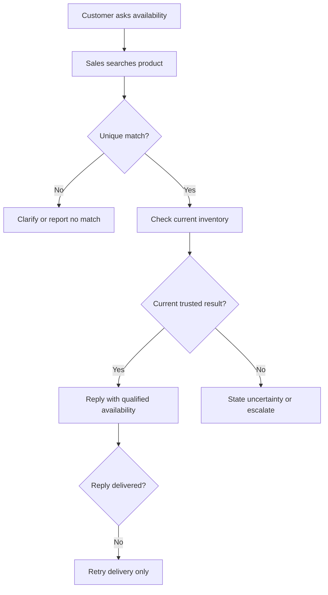
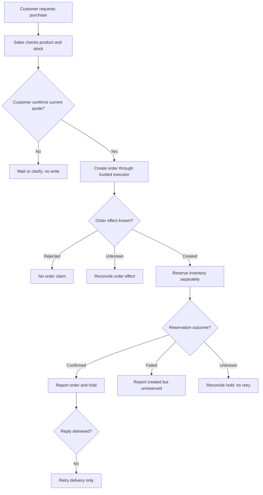
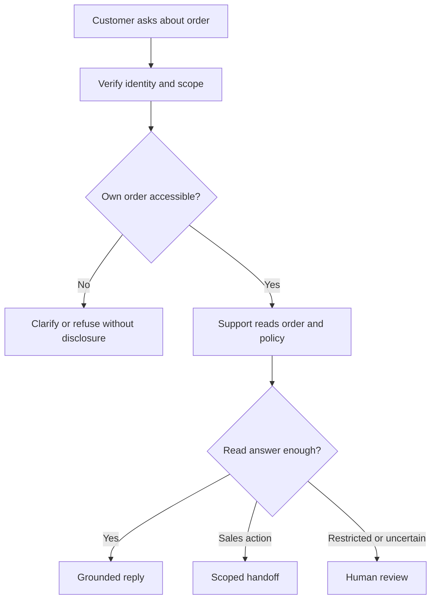
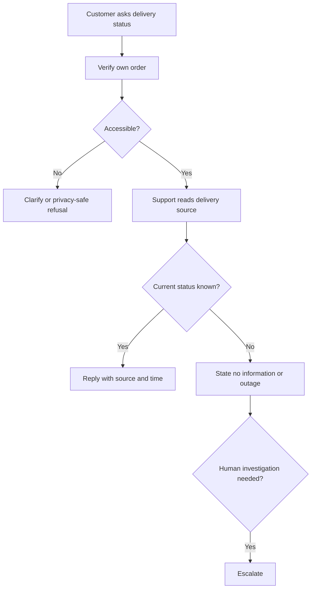
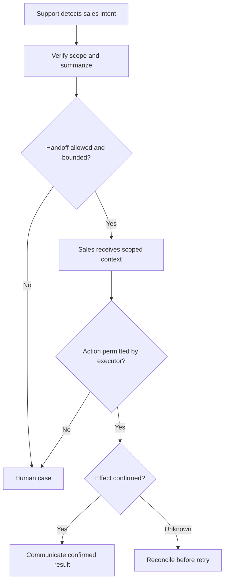
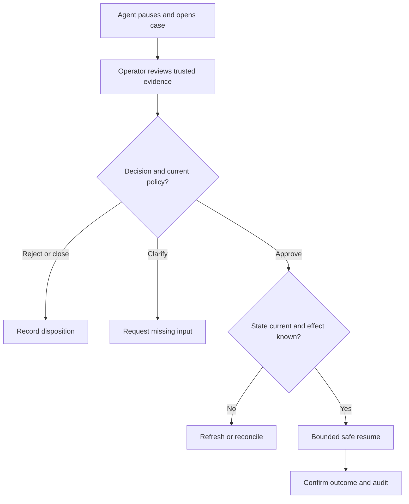
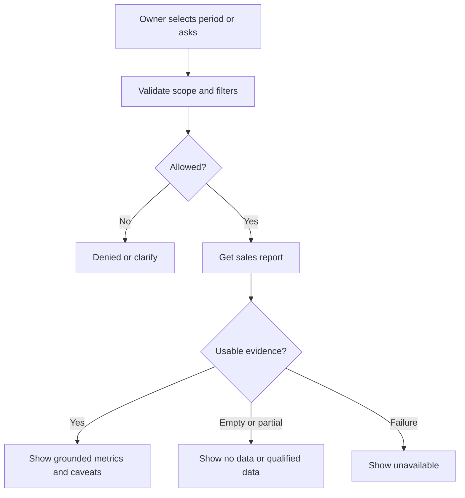
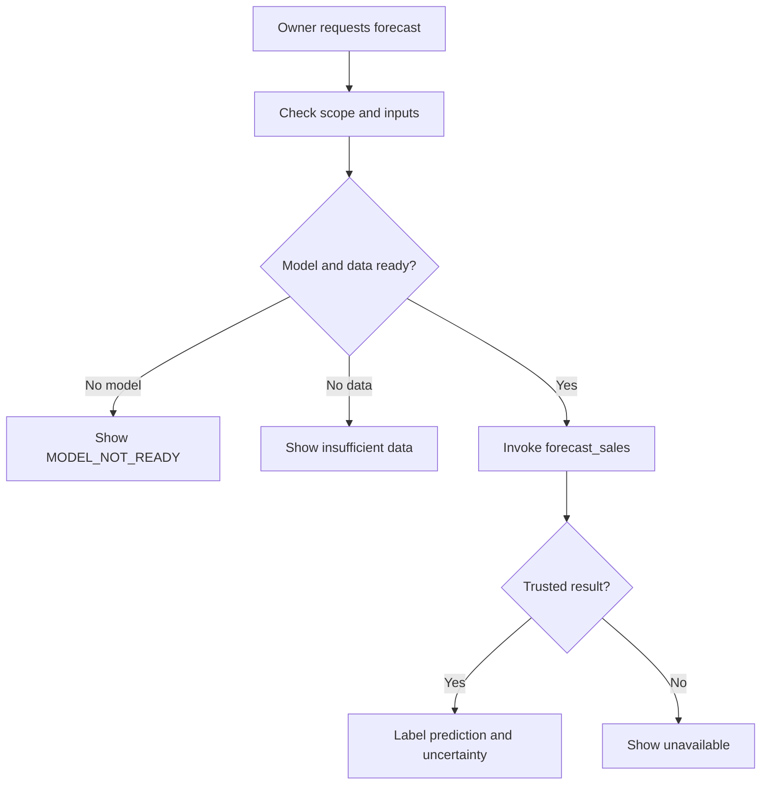
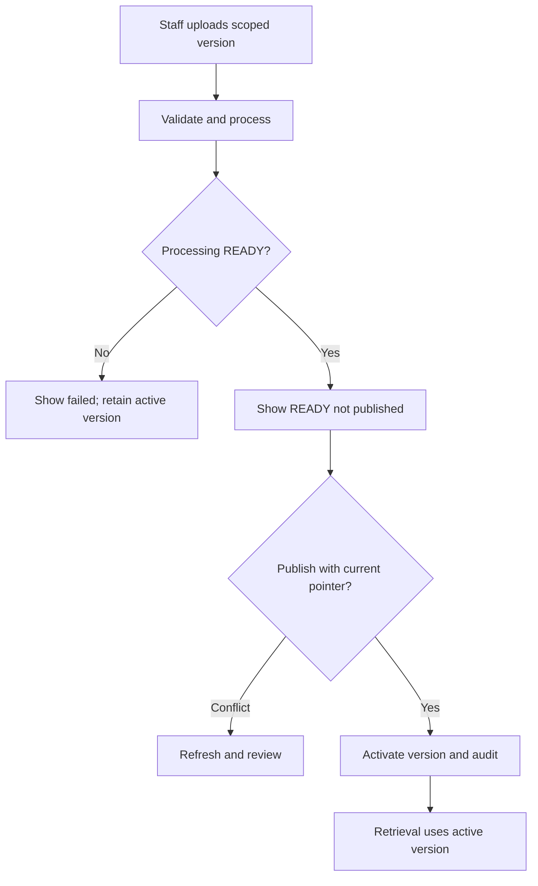
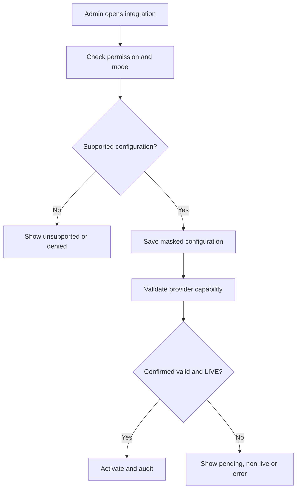

# Phase 2D — Core User Flows

## 2D.0 Scope and Source Authority

Phase 2D specifies **behavioral user paths**, not screens, layout, code, or visual design. Primary authority is [FINAL_MASTER_DEVELOPMENT_SAFE.pdf](../../research/master/release/FINAL_MASTER_DEVELOPMENT_SAFE.pdf), especially current D01 pp. 16, D03 p. 46, D04 p. 118, D05 p. 60, D06 p. 67, D07/V03 pp. 78–82, D09 p. 73, D10 p. 103, D11/V04 pp. 110–114, frontend contract pp. 115–116, FR-01–FR-11 pp. 32–34 and status pp. 301–303. Physical PDF page numbers are used. [Phase 2B UX validation](PHASE_2B_UX_VALIDATION.md) governs visibility/states; the [approved Phase 2C IA](PHASE_2C_INFORMATION_ARCHITECTURE.md) governs areas, routes and context links; [competitor research](UX_COMPETITOR_ANALYSIS.md) is a lower-priority presentation reference. Older [PRD](../PRD.md), [architecture](../ARCHITECTURE.md), [rules](../RULES.md) and [design](../DESIGN.md) remain working context, not authority over the master.

**Frozen IA:** staff areas are Overview; Conversations → Escalations; Business → Customers/Orders/Products/Inventory; Knowledge → Documents; Analytics → Forecasts; Administration → Integrations/Settings/Audit and restricted/contextual Agent Runs. Authentication is outside primary navigation. Customer Web Chat is a separate channel surface; native Instagram/WhatsApp/Telegram clients are not staff dashboard screens. The routes referenced below are conceptual Phase 2C routes, not implementation syntax. No new area or required agent/tool is introduced here.

**Evidence boundary:** M01–M07 passed scoped engineering gates (M04 with E02 `update_order` mutation denied); M08 remains partial/blocked. Working frontend, live channel adapters, M09–M13, replay-safe M12 human resume and M13 trained forecast are **not** evidenced. `forecast_sales` currently returns truthful `MODEL_NOT_READY`. Pilot/Final research has not run. Thus each flow is a **design contract**, not a claim that a user can already complete it in an application. Branch IDs `B01-A` etc. identify documented alternatives; terminal IDs `T01-A` etc. identify distinct **UX outcome meanings**, not persisted enums or database statuses. Mermaid diagrams are behavioral summaries, not wireframes or architecture diagrams.

## 2D.1 Flow Design Principles

1. Start from a person's goal and authorized entry surface; show agent/system work only where it changes a user-visible decision.
2. A request receipt, tool proposal, executor admission, committed business effect and outbound delivery are **five different facts**. Model wording cannot promote one to another (D03/D07).
3. `create_order` and `reserve_inventory` are separate effects. A created order may remain unreserved/NEEDS_ATTENTION; no refund, release or completion is invented (D04).
4. Preserve valid business, conversation, customer, order and task references across same-scope navigation. Refetch authoritative versions before a consequential decision; changing business clears prior-tenant data/drafts safely.
5. Every interruption has a named safe path: clarify, reject, show known failure, wait, hand off, escalate or reconcile. An unknown post-effect result is **not** a retryable generic error (V04).
6. The three agents may **propose only their admitted tools**. Principal, resource, current state and policy are independently checked by the trusted executor. Support never writes an Order; Analytics never mutates customer/order state.
7. Customer channel communication stays business-facing; staff may see role, evidence, operation reference and error class only within permissions. Neither view needs hidden chain-of-thought or raw secrets.
8. Actual sales facts, predictions, valid empty periods, stale sources and `MODEL_NOT_READY` remain semantically distinct (D10).

## 2D.2 Flow State Vocabulary

The following are **UX semantic states**, not newly frozen persisted enums. Only master-defined machine labels such as `OUTCOME_UNKNOWN`, `WAITING_HUMAN`, `MODEL_NOT_READY`, LIVE/MOCK/SANDBOX or documented domain states retain their existing meaning. Screens may use localized wording later, but cannot collapse these distinctions.

| State family | UX semantic values | Invariant |
| --- | --- | --- |
| Request | `idle`, `submitted`, `processing`, `clarification_required`, `completed`, `failed` | `submitted` means received for processing, not business success; `completed` needs a known terminal answer/status. |
| Business action | `proposed`, `awaiting_confirmation`, `executing`, `confirmed`, `rejected`, `known_failed`, `outcome_unknown`, `reconciling` | `confirmed` names the exact trusted effect; `outcome_unknown` means possible commit and never implies rollback. |
| AI/agent ownership | `assigned`, `active`, `waiting_for_user`, `handing_off`, `waiting_for_human`, `completed`, `stopped` | Ownership is visible to staff and must not imply two agents can write concurrently. |
| Escalation | `created`, `waiting_assignment`, `assigned`, `awaiting_decision`, `resume_pending`, `resolved`, `closed` | A queued case remains pending if no authorized operator is available; resume requires fresh checks. |
| Data/evidence | `current`, `stale`, `missing`, `inaccessible`, `unavailable`, `conflicting` | Valid empty is not unavailable; retrieved document text is not current Order/Inventory truth. |
| Outbound delivery | `response_ready`, `sending`, `delivered`, `delivery_failed` | Delivery status never rewrites a committed business result. |

Every flow uses scoped Business Brain context: request, conversation, structured facts, retrieved knowledge when relevant, runtime state, rules and permissions. The UI shows only the task-relevant authorized projection, not a raw ContextBundle page. A reason code/brief evidence explanation is allowed; hidden reasoning is not. See [Phase 2B state semantics](PHASE_2B_UX_VALIDATION.md#2b11-state-and-failure-ux).

## 2D.3 Flow 01 — Product Availability

### Flow 01 — Product Availability

#### Purpose

Answer whether a specified product/variant is available using authoritative catalog and inventory reads; an availability answer is **not** a reservation.

#### Primary actor

Customer.

#### Supporting actors / systems

Channel Provider, authenticated ingress, Adaptive Orchestrator, Sales Agent, Business Brain, trusted executor, catalog/inventory services, optional Human Operator.

#### Trigger

Customer asks about an item in Instagram, WhatsApp, Telegram or Web Chat.

#### Preconditions

The channel/session is accepted and bound to a trusted business scope; the item can be searched without inventing customer identity. Staff view requires authorized case scope. This is a design flow, not a live-channel claim.

#### Entry surface

Customer native channel/Web Chat; staff counterpart is `/conversations/:conversationId`.

#### Related screens

Conversations, Products and Inventory; Escalations and Agent Runs only if exception/inspection requires them.

#### Agent involvement

Orchestrator assigns Sales; staff sees Sales `assigned` → `active` → `completed` or waiting/handed off. Customer normally sees service progress, not internal agent names.

#### Business Brain context required

Request/item criteria, scoped conversation, current product/variant facts, inventory freshness/version, relevant rules and tool permissions. FAQ/RAG wording cannot substitute for stock.

#### Tools involved

Sales may propose `find_product` then `check_inventory`; executor validates scope/inputs and returns sourced read results. Both are staff-visible summaries; customer sees only the grounded business result.

#### Main success path

1. Customer sends item/variant inquiry; channel shows submitted while ingress authenticates, normalizes and durably accepts it.
2. Conversations shows the case and Sales responsibility to an authorized Operator; customer sees processing if a channel status can be conveyed.
3. Sales uses scoped request/conversation context and proposes `find_product`; executor returns a unique current match and source.
4. Sales proposes `check_inventory` for the matched variant; executor returns authoritative current availability and observed time/version.
5. Runtime forms a grounded answer naming the matched item and qualified availability, without claiming a hold.
6. Staff case/run shows the two trusted read results and source freshness; customer receives the business-facing answer.
7. Outbound delivery is recorded separately; only a delivered reply closes the communication loop, while the read result remains a separate fact.

#### User-visible states

Submitted/processing → product identified → current availability, zero stock or qualified unknown; clarification when needed. No raw tool IDs or private stock records.

#### Staff-visible states

Sales active, catalog result, inventory source/time, known no-match/zero/unavailable distinction, response-ready/delivery status and escalation reason where applicable.

#### Decision points

Unique match? Variant/quantity sufficient? Inventory data current? Tool authorized and dependency reachable? Can a grounded answer be delivered?

#### Failure / exception branches

| Branch | Condition and customer view | Staff view / next action | Terminal |
| --- | --- | --- | --- |
| B01-A | Exact match + stock known: qualified availability (including zero) | Product/stock source and freshness; no reservation event | T01-A grounded answer |
| B01-B | Multiple matches or missing variant: ask which item | Sales `waiting_for_user`; preserve candidates | T01-B clarification pending |
| B01-C | No product match: truthful no match or request new criteria | Valid empty catalog result, not outage | T01-C no match/clarification |
| B01-D | Inventory zero: item exists but is unavailable now | Current zero stock, not dependency error | T01-A grounded answer |
| B01-E | Inventory dependency unavailable/timeout: availability cannot be confirmed | Source failure; safe later check or escalation if needed | T01-D unavailable/pending |
| B01-F | Inventory evidence stale/conflicting: no firm availability claim | Refresh authoritative read; if unresolved escalate | T01-D unavailable/pending |
| B01-G | Tool rejected/unauthorized or foreign scope: privacy-safe inability to answer | Rejection reason, no foreign record disclosure; escalate if permitted | T01-E denied/escalated |
| B01-H | Reply delivery fails after reads: customer may not receive answer | Delivery failure; retry delivery only, not catalog business effects | T01-F delivery pending |

#### Escalation behavior

Create a scoped human case only when the needed fact cannot be safely obtained or policy requires human handling; carry item criteria, known source status and attempted reads. A valid no-match or zero-stock answer does not automatically need escalation.

#### Terminal states

T01-A grounded availability/zero-stock answer; T01-B clarification pending; T01-C no match with next question; T01-D source uncertainty pending/human; T01-E protected refusal/escalation; T01-F reply delivery pending. None implies reservation.

#### Context preservation

Conversation → Product/Inventory detail retains business, conversation, selected variant and return destination; on return, stock freshness is rechecked rather than trusting a cached preview.

#### Related master requirements

FR-01, FR-02, FR-04, FR-05, FR-06, FR-07; D03 p. 46, D04 p. 118, D06 p. 67.

#### Related IA surfaces

Customer channel/Web Chat; Conversations; Business → Products/Inventory; contextual Agent Runs/Escalations.

#### UX risks

Treating a retrieved product description as live stock, showing “available” after a stale read, or confusing receipt/delivery with inventory status.

#### Open questions

How much freshness detail should customer wording include, and when does stock-age policy require staff review?

## 2D.4 Flow 02 — Purchase and Inventory Reservation

### Flow 02 — Purchase and Inventory Reservation

#### Purpose

Let a Customer confirm a purchase and receive **separate truthful outcomes** for Order creation and inventory reservation under D04. This is the key partial-success flow.

#### Primary actor

Customer.

#### Supporting actors / systems

Channel Provider, Sales Agent, Adaptive Orchestrator, Business Brain, trusted executor, Order/Inventory services, Human Operator for exceptions.

#### Trigger

Customer chooses an item/quantity and expresses purchase intent through a supported channel.

#### Preconditions

Trusted business/channel/customer scope and required customer verification; item/price/quantity and current stock are sourced; quote/confirmation policy is satisfied. `create_order` is not invoked before required customer confirmation. No payment, automatic refund or guarantee of hold is inferred. M04 tool boundaries have scoped evidence, but no live frontend/channel purchase flow is claimed.

#### Entry surface

Customer native channel/Web Chat; staff watches `/conversations/:conversationId` and may open Business → Orders/Inventory.

#### Related screens

Conversations, Products, Inventory, Orders; Escalations and Agent Runs for partial/uncertain outcomes.

#### Agent involvement

Sales handles quote and may propose its admitted tools; executor independently authorizes. Staff sees Sales responsibility and each action phase. Customer sees a coherent purchase service, not internal agent/tool bureaucracy.

#### Business Brain context required

Request, conversation, verified customer identity, product/price and stock versions, quote/confirmation, current Order/operation state, business rules, tool permissions and completed effect refs. RAG text cannot approve a price or hold.

#### Tools involved

Sales may propose `find_product`, `check_inventory`, `find_customer` when needed, then **separate** `create_order` and `reserve_inventory`. Staff sees proposal/admission/result summaries per tool; Customer sees quote, confirmation and actual order/hold outcomes. `update_order` is not part of this purchase path.

#### Main success path

1. Customer requests item/quantity; Sales resolves product, current price and stock through authorized reads; UI distinguishes a quote from a reservation.
2. Customer receives the intended item/quantity/price and an explicit confirmation request; UI stays `awaiting_confirmation` until valid confirmation is received.
3. After confirmation and fresh state checks, Sales proposes `create_order`; executor checks principal, schema, policy, state and idempotency before domain commit.
4. A trusted ToolResult confirms a CREATED Order and operation reference. Staff Order detail shows that an Order exists **without yet asserting a hold**.
5. Sales separately proposes `reserve_inventory`; executor validates the current stock/version and performs or rejects the reservation atomically.
6. A trusted result confirms the hold. Order and Conversation now show **created + reserved**, with distinct operation/effect refs; Agent Run records both attempts/outcomes for authorized staff.
7. Customer receives a response that names the known order and reservation result; outbound delivery status is tracked separately from the two business effects.

#### User-visible states

Quote → confirmation requested/received → order processing → order created but reservation pending → order created and reserved, or explicit partial/unknown outcome. Customer never sees full completion before both effects are confirmed.

#### Staff-visible states

Sales active, source versions, quote/confirmation, each proposal/admission, Order CREATED result, reservation pending/confirmed/rejected/unknown, operation refs, reconciliation/escalation and outbound delivery status.

#### Decision points

Customer confirmed current quote? Did `create_order` commit? Is inventory version still current? Did `reserve_inventory` confirm, fail before effect or become `OUTCOME_UNKNOWN`? Was final reply delivered?

#### Failure / exception branches

| Branch | Customer sees | Operator sees; Order UI / Conversation / Agent Run | Escalation and terminal |
| --- | --- | --- | --- |
| B02-A — both confirmed | Order created **and** item reserved | Order shows two confirmed effects; Conversation names both; Run has separate ToolResults | No routine escalation; T02-A fully confirmed purchase |
| B02-B — created, shortage/known reserve failure | Order exists but item is **not reserved**; next handling pending | Order CREATED/NEEDS_ATTENTION as supported; Conversation partial status; Run shows confirmed `create_order` + known `reserve_inventory` failure | Escalate or policy-defined safe handling; T02-B partial order/unreserved |
| B02-C — created, reserve `OUTCOME_UNKNOWN` | Order existence may be confirmed; reservation confirmation pending, not success/failure | Order/Conversation show unknown hold; Run preserves operation ref and possible-commit evidence; reconciliation-needed Escalation | Required reconciliation, no blind retry; T02-C unknown reservation/pending |
| B02-D — `create_order` rejected before effect | Purchase could not be created; no order claim | Order has no new confirmed entity; Conversation rejection; Run reason/no-effect evidence | Clarify/correct or escalate if policy blocks; T02-D no order created |
| B02-E — stale state/version before reserve | Hold not confirmed; order may already exist | Order created with stale reservation attempt; Conversation partial; Run rejection/version reason | Refresh/reconfirm or escalate; never assume hold; T02-B partial order/unreserved |
| B02-F — customer not confirmed | Confirmation still required; no order/hold claim | Conversation awaiting confirmation; no write ToolResult or Order; Run waiting for user | No escalation unless timeout/policy requires; T02-E awaiting confirmation |
| B02-G — final delivery fails after both commits | No guaranteed received confirmation | Order remains created/reserved; Conversation marks `delivery_failed`; Run/Audit retain both committed refs | Retry **delivery only**; T02-F effects confirmed, communication pending |
| B02-H — `create_order` `OUTCOME_UNKNOWN` | Order creation confirmation pending; no reservation promised | No second write until first effect reconciled; operation ref and Escalation visible | Reconcile before reserve/retry; T02-G unknown order effect/pending |
| B02-I — protected identity/permission failure | Cannot proceed with purchase until verified/authorized | Rejected before effect, privacy-safe scope; no Order mutation | Clarify identity or escalate; T02-D no order created |
| B02-J — product/stock dependency failure before write | Quote/availability cannot be confirmed | No write attempt; source failure vs valid empty separated | Safe wait/clarify; T02-H pre-write unavailable |

#### Escalation behavior

Escalate confirmed partial Order, unknown possible commit, unsupported business policy or unresolved permission/stock conflict with verified identity, quote, customer confirmation, Order/operation refs and remaining task. An Operator must not be asked to “approve success” when an effect is unknown; reconciliation comes first. Current E02 `update_order` mutation denial cannot be used as a hidden compensation path.

#### Terminal states

T02-A created and reserved; T02-B created but unreserved/needs attention; T02-C created with reservation unknown/reconciling; T02-D no Order created after known rejection/denial; T02-E awaiting confirmation; T02-F both business effects confirmed but delivery pending; T02-G Order effect unknown; T02-H pre-write source unavailable. These labels are UX outcomes, not new database states.

#### Context preservation

Conversation → Order/Inventory retains business, customer, item, quote and return link; Order detail refetches versions. A new session or tenant switch cannot reuse stale confirmation. The two operation refs remain linked to the same purchase case without merging their effects.

#### Related master requirements

FR-01, FR-02, FR-03, FR-04, FR-05, FR-06, FR-07, FR-10; D04 p. 118, D07 p. 79, V04 p. 114.

#### Related IA surfaces

Customer channel/Web Chat; Conversations; Business → Products/Inventory/Orders; contextual Agent Runs; nested Escalations.

#### UX risks

Calling an Order-only result “purchase complete”; repeating a possibly committed write; showing full success because the final message was composed; or letting a delivery retry trigger another `create_order`/`reserve_inventory`.

#### Open questions

What exact quote/confirmation expiry and stock-refresh policy applies? Which approved Order states and staff actions handle shortage without inventing refund/release semantics?

## 2D.5 Flow 03 — Order Support

### Flow 03 — Order Support

#### Purpose

Answer a Customer's authorized order question with current Order state and applicable policy, or transfer work safely when the question requires a mutation or human judgment.

#### Primary actor

Customer.

#### Supporting actors / systems

Channel Provider, Support Agent, Business Brain/knowledge provider, trusted executor, Order service, Sales Agent for an eligible handoff, Human Operator.

#### Trigger

Customer asks about an Order, its status or a policy-dependent issue.

#### Preconditions

Channel/business scope is trusted; protected Order data is not disclosed until CustomerIdentity/ownership is verified. A supplied Order ID or phone number alone is not proof. The policy source, if used, must be published/current and ACL-permitted.

#### Entry surface

Customer channel/Web Chat; authorized staff case in Conversations.

#### Related screens

Conversations, Customers, Orders, Knowledge source reference, contextual Agent Runs; Escalations for human work.

#### Agent involvement

Support remains responsible for read-oriented diagnosis and grounded answer. It requests a Support → Sales handoff only when a **permitted Sales write** is actually needed; it escalates restricted/unsupported requests or unresolved evidence. Support never proposes `create_order`, `update_order` or `reserve_inventory`.

#### Business Brain context required

Request, scoped conversation, verified customer/order relationship, current Order facts and version, applicable published policy/evidence, runtime attempts, rules and effective permissions. Derived conversation summary cannot override an Order record.

#### Tools involved

Support may propose `find_customer` when binding is needed and `get_order` for a protected read. Knowledge retrieval is part of Business Brain, **not** an eleventh canonical business tool. Tool details are staff-visible where authorized; Customer receives the verified status/policy conclusion.

#### Main success path

1. Customer asks an Order question; channel receipt and processing are separate from answer delivery.
2. Support becomes active; backend resolves a trusted Customer/business scope and requests clarification if ownership evidence is insufficient.
3. When necessary, Support proposes `find_customer`; executor returns an authorized identity match or protected refusal.
4. Support proposes `get_order`; executor checks ownership and returns current Order/version or privacy-safe inaccessibility.
5. Brain supplies a current, ACL-permitted policy source only if the question needs one; Support checks it against authoritative Order state.
6. A grounded answer names the actual Order status and relevant policy limitation; staff sees source/version and the read outcomes.
7. The answer is sent; outbound delivery is tracked separately. Case resolves only to a known answer, clarification, handoff or controlled escalation.

#### User-visible states

Processing, identity clarification, grounded own-Order answer, unsupported/review pending or safe refusal. Customer does not see foreign-order existence or raw policy internals.

#### Staff-visible states

Support active, verification status, protected read result, source/version, policy conflict/missing-source flag, current/next owner and outbound delivery.

#### Decision points

Is Customer binding sufficient? Is the Order owned and current? Is policy needed, available and non-conflicting? Can Support answer without a write? Is a Sales-permitted action available? Must a person decide?

#### Failure / exception branches

| Branch | Customer view | Staff view / next action | Terminal |
| --- | --- | --- | --- |
| B03-A — valid owned Order | Grounded current status/policy answer | Support read and evidence refs confirmed | T03-A answered |
| B03-B — unknown Order | Privacy-safe “cannot locate/verify this order” with clarification path | Valid no-match distinguished from dependency failure | T03-B clarification/no match |
| B03-C — inaccessible/foreign Order | Same privacy-safe non-disclosing response | Authorization/ownership denial; no foreign object data | T03-C protected refusal |
| B03-D — ambiguous/missing Customer binding | Request permitted verification detail; no Order disclosure | `find_customer` ambiguous/missing, Support waits | T03-B clarification pending |
| B03-E — policy unavailable or conflicting | Do not invent policy outcome; case needs review | Missing/conflict flag, cited source versions if allowed | T03-D human/policy review |
| B03-F — tool/backend dependency unavailable | Cannot confirm current Order state | Distinguish outage from no Order; bounded read recovery/escalation | T03-E source unavailable |
| B03-G — supported Sales write required | Service continues without forcing Customer to restart | Support creates scoped handoff envelope; Sales refreshes permissions/state | T03-F handed to Flow 05 |
| B03-H — unsupported/restricted operation | Human review needed; no false promise | E02/other restriction reason, verified facts preserved | T03-D human/policy review |
| B03-I — outbound answer delivery fails | Receipt of answer not assumed | Delivery failure; retry message only | T03-G reply delivery pending |

#### Escalation behavior

Escalate unresolved identity/policy conflict, unsupported write, restricted action or repeated dependency failure with only authorized verified facts and attempted read refs. A readable, owned Order question stays with Support; a genuinely Sales-permitted mutation follows Flow 05; an E02-denied mutation follows human review, not a forced tool call.

#### Terminal states

T03-A grounded answer; T03-B clarification/no match; T03-C privacy-safe refusal; T03-D human/policy review; T03-E source unavailable/pending; T03-F transferred to Sales; T03-G delivery pending. Handoff is an intermediate outcome for this flow, not proof of business completion.

#### Context preservation

Conversation → Customer/Order/Document ref carries business, case and verified binding, not unrestricted record copies. Return to the thread restores the task; a stale Order is refreshed before any later action. Handoff uses Flow 05's scoped envelope.

#### Related master requirements

FR-01, FR-02, FR-04, FR-05, FR-06, FR-07, FR-08, FR-10; Support pp. 62–63, D05 p. 60, D06 p. 67.

#### Related IA surfaces

Customer channel/Web Chat; Conversations; Business → Customers/Orders; Knowledge evidence; contextual Agent Runs; nested Escalations.

#### UX risks

Disclosing a foreign Order; using an old FAQ against current state; presenting a Support read as authorized mutation; or equating policy absence with permission.

#### Open questions

Which customer-verification challenge and policy precedence are approved for each channel and business?

## 2D.6 Flow 04 — Delivery Status

### Flow 04 — Delivery Status

#### Purpose

Answer a Customer's delivery question from a protected Order and a scoped external delivery-status source without treating provider silence as “not shipped.”

#### Primary actor

Customer.

#### Supporting actors / systems

Channel Provider, Support Agent, trusted executor, Order service, external delivery provider/adaptor, optional Human Operator.

#### Trigger

Customer asks where an Order/shipment is.

#### Preconditions

Customer–Order ownership is verified; external status is retrieved under trusted business scope and has an observed time/source. The provider may be unavailable independently of Order state.

#### Entry surface

Customer channel/Web Chat; staff case in Conversations, with Order detail as a linked source.

#### Related screens

Conversations, Customers/Orders, Integrations for authorized admin provider health, contextual Agent Runs and Escalations for unresolved cases.

#### Agent involvement

Support is active and may clarify Order reference. It does not modify Order/Inventory or infer shipping success from an unavailable feed.

#### Business Brain context required

Request, conversation, verified identity/Order link, current Order/version, delivery source result and freshness, rules, permissions, previous attempts. No knowledge text can fabricate live courier state.

#### Tools involved

Support may propose `find_customer` if binding is needed, `get_order` and `get_delivery_status`. The latter is an external/scoped read, not an Order write. Staff can inspect safe result/reason; Customer receives only the business-facing status and uncertainty.

#### Main success path

1. Customer submits delivery question; Support is assigned and staff case shows the active specialist.
2. Backend confirms business and customer ownership; Support asks for missing permitted identification if needed.
3. Support reads the own Order with `get_order` when required, then requests `get_delivery_status` for its authorized reference.
4. Executor/adaptor returns a known provider status with source and observed time; Support checks freshness and meaning.
5. Customer receives the known status with appropriate time qualification, not a guess about future arrival.
6. Staff sees Order/delivery source, read outcomes, provider/delivery-message status and a link to admin integration health only if authorized.
7. If outbound reply fails, only delivery communication is retried; no business state is changed.

#### User-visible states

Processing, status known, no information yet, source currently unavailable/stale, verification needed or human follow-up pending.

#### Staff-visible states

Support active, Order ownership proof, provider result/time, external timeout/unavailable class, stale marker and message-delivery outcome.

#### Decision points

Is Order accessible? Does the provider have a known status? Is it current enough? Did a timeout happen before a status was observed? Is escalation needed for a prolonged unresolved case?

#### Failure / exception branches

| Branch | Customer view | Staff view / next action | Terminal |
| --- | --- | --- | --- |
| B04-A — current status known | Qualified delivery status and observed time | Source/status ref, no Order mutation | T04-A grounded status |
| B04-B — no delivery information | No status available yet; do not say “not shipped” | Valid missing provider result vs outage distinguished | T04-B no information |
| B04-C — provider unavailable | Cannot confirm current delivery status | Integration/dependency failure; bounded later check | T04-C source unavailable |
| B04-D — provider timeout | Status confirmation pending | Timeout class; no repeated unbounded reads | T04-C source unavailable/pending |
| B04-E — protected Order inaccessible | Privacy-safe refusal/verification | No foreign Order/status details | T04-D denied/clarification |
| B04-F — result stale | Last known status labelled old, or current status unknown | Refresh if safe; show observed time | T04-E stale/pending |
| B04-G — external status unknown/contradictory | Do not invent a shipping conclusion | Unknown/conflict evidence; escalate if consequential | T04-F uncertain/human |
| B04-H — reply delivery failed | No assumption Customer received answer | Delivery-only retry, provider status remains unchanged | T04-G reply delivery pending |

#### Escalation behavior

Escalate inaccessible/ambiguous ownership, conflicting provider/Order evidence or prolonged source failure when a person must investigate. Carry verified Order ref, provider observed time and attempted reads; do not ask an Operator to “fix shipment” through a non-existent tool.

#### Terminal states

T04-A grounded known status; T04-B valid no-information status; T04-C provider unavailable/pending; T04-D protected denial/clarification; T04-E stale source; T04-F conflict/human review; T04-G reply delivery pending.

#### Context preservation

Conversation → Order detail carries scoped case/Order ref and return link; Integrations health is separately permissioned and must not expose customer records to an Admin by default.

#### Related master requirements

FR-01, FR-02, FR-04, FR-05, FR-06, FR-07, FR-10; Support pp. 62–63, D03 p. 46, security p. 106.

#### Related IA surfaces

Customer channel/Web Chat; Conversations; Business → Orders/Customers; contextual Agent Runs/Escalations; Administration → Integrations only for provider diagnosis.

#### UX risks

Equating provider outage with “not shipped,” exposing a foreign shipment, hiding result age, or retrying a business mutation because an answer was not delivered.

#### Open questions

What freshness limit and provider-specific status vocabulary will be approved, and when should prolonged unknown status become operator work?

## 2D.7 Flow 05 — Support-to-Sales Handoff

### Flow 05 — Support-to-Sales Handoff

#### Purpose

Move an eligible customer conversation from Support to Sales without losing context or silently granting Support write privileges. A handoff is a specialist-routing decision, not authorization for an Order mutation. The current E02 `update_order` policy remains denied; any future exception requires an approved rule and trusted execution.

#### Primary actor

Customer with an existing Order or purchase question.

#### Supporting actors / systems

Support Agent, Sales Agent, orchestrator, permission/policy gate, Operator for denied or ambiguous changes, executor and channel adapter.

#### Trigger

Support identifies an authorized sales-related next step or the Customer asks to change/add to an Order.

#### Preconditions

The conversation is scoped to one business; Customer/Order binding is verified before protected detail is revealed. The orchestrator has a bounded handoff budget and records the reason.

#### Entry surface

Customer channel/Web Chat or an existing conversation; staff can observe the handoff in Conversations.

#### Related screens

Conversations list/detail, Customers detail, Orders detail, Escalations and contextual Agent Runs.

#### Agent involvement

Support may read with `find_customer`, `get_order`, `check_inventory`, `get_delivery_status`. It passes a concise, provenance-aware case summary to Sales. Sales alone may propose its allowed tools, but the executor still enforces business policy. Neither specialist can override the E02 denial by switching agents.

#### Business Brain context required

Verified Customer/Order links, current Order version, inventory evidence and freshness, conversation history, customer intent, permissions, business rules, available tools, previous handoffs and pending effects.

#### Tools involved

Support read tools above; Sales may use `find_product`, `check_inventory`, `find_customer`, `get_order`, `create_order`, `update_order`, `reserve_inventory` subject to policy. Handoff itself is orchestration, not a business mutation. Current `update_order` is denied for E02; do not present it as executable.

#### Main success path

1. Support identifies the sales intent and verifies the Customer/Order context before sharing it with Sales.
2. Orchestrator records handoff reason, source and target specialist, current case and bounded attempt count; UI shows the transfer is underway.
3. Sales receives the same authorized scope and a summary distinguishing trusted facts from customer claims.
4. Sales checks current Order/inventory as needed and proposes a permitted next action or clarification.
5. Executor rechecks permission, policy, version and idempotency for any proposed effect. A confirmed effect is reported only after trusted confirmation.
6. If the request is the currently denied E02 Order update, Sales does not mutate; it routes to a human decision/follow-up with intact context.
7. The Customer sees one coherent response or pending handoff, not a second conflicting specialist message; staff sees ownership and effect status.

#### User-visible states

Transfer pending, Sales responding, clarification requested, action denied/pending human, confirmed permitted action, effect unknown or message delivery pending.

#### Staff-visible states

Support-to-Sales ownership, handoff reason/attempts, verified scope, latest Order version, policy result, effect outcome and escalation assignee.

#### Decision points

Is the Customer/Order authorized? Is Sales the appropriate target? Has the handoff budget been used? Is the requested write permitted now? Is the Order version current? Was an effect confirmed?

#### Failure / exception branches

| Branch | Customer view | Staff view / next action | Terminal |
| --- | --- | --- | --- |
| B05-A — permitted Sales resolution | Grounded answer or explicitly confirmed allowed effect | Sales owns case; trusted result captured | T05-A resolved |
| B05-B — E02 `update_order` denied | No claim that Order changed; human follow-up offered | Policy denial, no write; route to Operator | T05-B policy-denied/human |
| B05-C — Order version stale | Change not confirmed; refresh or ask to review | Conflict/version evidence; re-read before a new proposal | T05-C stale/clarify |
| B05-D — insufficient stock | Explain unavailable quantity and alternatives | No reservation unless independently confirmed | T05-D unavailable |
| B05-E — repeated/looping handoff | One pending human response | Stop agent loop at budget; assign Operator | T05-E human handoff |
| B05-F — permission/ownership denied | Privacy-safe refusal or verification request | Do not leak Order data or hand it across scopes | T05-F denied |
| B05-G — attempted write outcome unknown | Action being checked, not confirmed or failed | Freeze duplicate writes; reconcile trusted effect before retry | T05-G `OUTCOME_UNKNOWN` |
| B05-H — reply delivery failed | Do not assume Customer saw resolution | Delivery retry only; preserve confirmed business effect | T05-H delivery pending |

#### Escalation behavior

E02 policy denial, exhausted handoff budget, disputed ownership or an unknown effect goes to a human with reason, verified context, policy decision and safe next action. A human cannot be offered a one-click bypass of a denied policy; approval design must distinguish policy change from case review.

#### Terminal states

T05-A resolved; T05-B policy-denied/human; T05-C stale/clarify; T05-D unavailable; T05-E human handoff; T05-F denied; T05-G `OUTCOME_UNKNOWN`; T05-H delivery pending.

#### Context preservation

Conversation → Order/Customer detail → Escalation preserves case ref, verified identity, Order version, transcript summary, handoff chain, reason, pending effect and return link; no cross-tenant raw transcript transfer.

#### Related master requirements

FR-01, FR-02, FR-03, FR-04, FR-05, FR-06, FR-07, FR-08, FR-10; D05 p. 60, V03 p. 82, E02 policy status, D11 p. 111.

#### Related IA surfaces

Customer channel/Web Chat; Conversations → Escalations; Business → Customers/Orders/Inventory; restricted Agent Runs and Audit where authorized.

#### UX risks

Agent switch mistaken for permission elevation, duplicate writes across specialists, lost order version or contradictory customer messages.

#### Open questions

What explicit business policy would ever allow E02 `update_order`, and who may authorize it? What handoff budget and customer wording are approved?

## 2D.8 Flow 06 — Human Escalation and Safe Resume

### Flow 06 — Human Escalation and Safe Resume

#### Purpose

Define the operator decision and safe return path for unresolved agent work. This is UX/design intent only: durable human resume (M12/D11) is not implemented.

#### Primary actor

Authorized Operator, with the Customer as affected party.

#### Supporting actors / systems

Orchestrator, policy gate, executor, specialist agent, notification/delivery adapter and Audit.

#### Trigger

Low confidence, conflicting evidence, policy denial, unknown effect, repeated failure, explicit human request or an action requiring human judgment.

#### Preconditions

The case contains a stable scoped reference and reason. Operator authentication, role and current business access are verified at decision time. A pending effect is classified before any resume.

#### Entry surface

Conversations → Escalations; contextual links from Conversations, Orders and restricted Agent Runs.

#### Related screens

Escalation queue/detail, Conversations detail, Order/Customer detail, restricted Agent Runs and Audit.

#### Agent involvement

Agent pauses and supplies a concise grounded summary, attempted tools and open decision. After a permitted decision, it can resume only from a validated checkpoint and re-evaluated state—not from a stale model proposal.

#### Business Brain context required

Conversation and business state versions, trusted tool results, history, rules, available tools, permissions, previous approvals/denials, action idempotency key and unresolved unknown effects.

#### Tools involved

No new canonical business tool. A resumed specialist may propose only its existing allowed tools, with fresh executor checks. Operator decision and audit are workflow controls, not a blanket grant to execute `update_order` or repeat an uncertain mutation.

#### Main success path

1. System creates a scoped escalation with reason, priority, provenance, proposed next step, unresolved effects and Customer communication state.
2. Customer sees a truthful human-review/pending message, not an invented completion promise.
3. Authorized Operator opens case, reviews evidence and current state, and chooses approve where policy allows, reject, clarify, or close without resume.
4. Before any resume, system rechecks Operator permission, case version, policy, idempotency and whether the effect is already confirmed or `OUTCOME_UNKNOWN`.
5. Approved safe path resumes a bounded agent step or Operator action; rejected/clarify/closed paths do not run the proposed mutation.
6. Each decision and resulting effect/communication state is auditable; Customer gets a status/outcome only after its basis is known.

#### User-visible states

Human review pending, more information needed, request declined, safely resumed, confirmed outcome or still unresolved.

#### Staff-visible states

Queue priority/assignee, case version, reason, trusted evidence, proposed action, permission/policy state, prior decisions, unknown-effect guard and audit trail.

#### Decision points

Is the Operator still authorized? Is the case/version current? Is the proposed action policy-permitted? Is the effect known? Was a decision already submitted? Is a safe checkpoint available?

#### Failure / exception branches

| Branch | Customer view | Staff view / next action | Terminal |
| --- | --- | --- | --- |
| B06-A — permitted approval | Outcome pending until trusted effect; then confirmed | Record approval, revalidate, bounded resume | T06-A resumed/confirmed or pending |
| B06-B — reject | Clear decline with appropriate reason | Record rejection; no proposed write | T06-B rejected |
| B06-C — clarify | Specific request for missing information | Await reply; no premature resume | T06-C clarification pending |
| B06-D — close without resume | Case closure/follow-up statement | Record disposition; no effect claimed | T06-D closed |
| B06-E — stale case/business version | Review remains pending | Refresh evidence; require new decision | T06-E stale review |
| B06-F — duplicate decision | No duplicate action | Idempotent decision handling; show existing result | T06-F already decided |
| B06-G — Operator permission lost | No protected detail disclosed | Reject interaction, reassign authorized Operator | T06-G access denied |
| B06-H — prior write `OUTCOME_UNKNOWN` | Still being checked | Reconcile; disable mutation replay/approval until known | T06-H reconciliation pending |
| B06-I — no Operator available | Honest pending status | Queue with ownership/age; no autonomous bypass | T06-I unassigned pending |
| B06-J — resume dependency/limit failure | Follow-up pending, no success claim | Preserve checkpoint and bounded retry/human handling | T06-J resume blocked |

#### Escalation behavior

The case remains human-owned until a known safe disposition. Approval cannot override a hard policy denial or unknown-effect guard. Escalation itself does not guarantee delivery to an Operator; queue/assignment failure must be visible.

#### Terminal states

T06-A safe resumed/confirmed or explicitly pending; T06-B rejected; T06-C clarification pending; T06-D closed; T06-E stale review; T06-F already decided; T06-G denied/reassign; T06-H reconciliation pending; T06-I unassigned; T06-J resume blocked.

#### Context preservation

Stable case ID, business/Customer scope, conversation summary, citations, tool attempts/results, state versions, policy decisions, operator identity/decision and outbound delivery status must survive navigation and future durable resume. Do not rely on browser memory as the checkpoint.

#### Related master requirements

FR-01, FR-03, FR-04, FR-05, FR-06, FR-07, FR-08, FR-10; D11 p. 111, V04 p. 114, M12 design-only status.

#### Related IA surfaces

Conversations → Escalations; Conversations detail; Business → Orders/Customers; restricted Agent Runs; Administration → Audit.

#### UX risks

Treating a human click as authorization, replaying a committed effect, losing provenance on resume or implying the durable workflow already exists.

#### Open questions

What is the approved assignment/SLA policy, how long may a case wait, and which decisions can be safely resumed after M12 is built?

## 2D.9 Flow 07 — Owner Sales Analytics

### Flow 07 — Owner Sales Analytics

#### Purpose

Let an authorized Owner inspect grounded historical sales, with visible scope, period, provenance and data quality. Analytics results are not forecasts.

#### Primary actor

Owner (or an explicitly authorized analytics role).

#### Supporting actors / systems

Analytics Agent, report service/warehouse or PostgreSQL data source, executor, permissions and Audit.

#### Trigger

Owner opens Overview/Analytics or asks a sales question for a chosen time range.

#### Preconditions

Authenticated business-scoped staff session; report period and metric definitions are available. The underlying data may be incomplete and must be labelled.

#### Entry surface

Overview KPI link or Analytics area.

#### Related screens

Overview, Analytics report, optional Customers/Orders details, contextual Agent Runs and Audit for authorized diagnosis.

#### Agent involvement

Analytics Agent translates the question into a permitted report request and explains results; it cannot invent causal explanations or silently substitute a forecast.

#### Business Brain context required

Business scope, selected period/time zone, metric definitions, report freshness, data completeness, historical sales/Order facts, rules, permissions and cited tool response.

#### Tools involved

`get_sales_report` only for this historical flow. `forecast_sales` belongs to Flow 08 and must be a distinct action and state.

#### Main success path

1. Owner selects a period/metric or asks a historical sales question.
2. UI shows scope and filters; Analytics proposes `get_sales_report` with bounded parameters.
3. Executor checks role/business scope and obtains a trusted report with source, period, freshness and completeness metadata.
4. Analytics summarizes supported figures and uncertainty, distinguishing observations from interpretation.
5. UI shows values, units, period, source/freshness, any caveats and a path to inspect the supporting report.

#### User-visible states

Loading, report ready, no data, incomplete data, invalid period, access denied or report unavailable.

#### Staff-visible states

Same Owner view plus authorized diagnostic result/error class and report provenance; no customer-level leak through aggregate cards.

#### Decision points

Is the period valid and in scope? Is the report complete enough? Is a result empty versus unavailable? Does a requested conclusion exceed the evidence?

#### Failure / exception branches

| Branch | Owner view | Staff/diagnostic next action | Terminal |
| --- | --- | --- | --- |
| B07-A — valid report | Grounded metrics with period/source | Retain report provenance | T07-A report ready |
| B07-B — valid empty report | Explicit no data, not zero business performance | Check selected range and source completeness | T07-B no data |
| B07-C — incomplete/stale data | Values visibly qualified or withheld | Surface missing interval/freshness | T07-C partial |
| B07-D — invalid range/metric | Correctable filter error | No tool loop; request valid input | T07-D clarify |
| B07-E — permission denied | Access denied without data | Audit denial; no report disclosure | T07-E denied |
| B07-F — report dependency failure | Report temporarily unavailable | Bounded retry; preserve filters | T07-F unavailable |
| B07-G — unsupported causal claim | State that report alone cannot establish cause | Offer grounded descriptive answer only | T07-G limited answer |

#### Escalation behavior

Repeated data-quality discrepancies or permission disputes go to an authorized Operator/Admin; a dependency outage does not create a fabricated number.

#### Terminal states

T07-A grounded report; T07-B valid no data; T07-C qualified partial; T07-D clarification; T07-E denied; T07-F unavailable; T07-G limited descriptive answer.

#### Context preservation

Overview → Analytics → supporting Orders retains selected period, metric and business scope with back path. A deep link rechecks current permission and does not cache another business's report.

#### Related master requirements

FR-01, FR-06, FR-07, FR-09; analytics evidence and D10 separation of historical/forecast.

#### Related IA surfaces

Overview; Analytics; Business → Orders/Customers where authorized; restricted Agent Runs/Audit.

#### UX risks

Presenting missing data as zero, hiding time zone/freshness, inferring causation or confusing report with forecast.

#### Open questions

Which historical metric formulas and data-completeness thresholds will be approved for the MVP dashboard?

## 2D.10 Flow 08 — Forecast Request

### Flow 08 — Forecast Request

#### Purpose

Let an authorized Owner request a clearly labelled prediction, without presenting it as historical fact. The current M13 forecast artifact is absent; the current outcome is `MODEL_NOT_READY`, not a live forecast.

#### Primary actor

Owner (or explicitly authorized analytics role).

#### Supporting actors / systems

Analytics Agent, forecast model/service when available, executor, permissions and report data source.

#### Trigger

Owner enters Analytics → Forecasts or explicitly asks for a future sales estimate.

#### Preconditions

Authenticated business-scoped session and valid forecast horizon. A trained approved model/artifact and sufficient eligible history would be required for a real result; these are not currently in place.

#### Entry surface

Analytics → Forecasts, with a contextual link from historical Analytics where appropriate.

#### Related screens

Forecasts, Analytics report, Overview and restricted Agent Runs for authorized diagnostics.

#### Agent involvement

Analytics Agent may propose `forecast_sales` and explain its result/status. It must not generate a numeric forecast from prose when the model is missing.

#### Business Brain context required

Business scope, requested horizon/granularity, historical data coverage, model version/readiness, input freshness, confidence/uncertainty, rules and permissions.

#### Tools involved

`forecast_sales` only for prediction. `get_sales_report` may supply historical context but cannot replace a missing model or be relabelled as a forecast.

#### Main success path

1. Owner selects horizon/granularity and sees that the action requests a prediction.
2. Analytics validates parameters, scope, model readiness and eligible history.
3. When a model is truly available, executor invokes `forecast_sales` with bounded inputs and receives a versioned result with uncertainty/limitations.
4. UI separates prediction from historical values, labels horizon, model/data freshness and uncertainty, and links back to historical evidence.
5. In the current repository state, readiness check yields `MODEL_NOT_READY`; UI shows an unavailable explanation rather than a fabricated chart or number.

#### User-visible states

Input needed, generating, forecast ready (future conditional), insufficient data, unsupported horizon, `MODEL_NOT_READY`, service unavailable or access denied.

#### Staff-visible states

Model artifact/readiness, data coverage, parameters, version, failure class and permission decision; diagnostics are restricted.

#### Decision points

Is the request authorized and supported? Is model artifact available? Is history sufficient? Does the result include usable uncertainty? Was the model call successful?

#### Failure / exception branches

| Branch | Owner view | Staff/diagnostic next action | Terminal |
| --- | --- | --- | --- |
| B08-A — real model result (future) | Prediction, horizon and uncertainty explicitly labelled | Record model/data version and provenance | T08-A forecast ready |
| B08-B — current artifact absent | `MODEL_NOT_READY`; no numeric prediction | M13 artifact prerequisite; keep historical Analytics separate | T08-B model not ready |
| B08-C — insufficient history | Explain data requirement without invented numbers | Show coverage gap; no silent extrapolation | T08-C insufficient data |
| B08-D — unsupported horizon/metric | Correctable input guidance | Reject unsupported parameters | T08-D clarify |
| B08-E — model/service unavailable | Temporary inability to forecast | Bounded retry after readiness; preserve inputs | T08-E unavailable |
| B08-F — partial/stale input data | Warning or withheld prediction per approved quality rule | Identify missing interval/freshness | T08-F data-quality blocked |
| B08-G — permission denied | Access denied | No model/data disclosure | T08-G denied |

#### Escalation behavior

Model-readiness and data-quality issues become implementation/operations work; they are not resolved by an Operator inventing a prediction. Business-critical interpretations require human review of assumptions.

#### Terminal states

T08-A conditional real forecast; T08-B `MODEL_NOT_READY`; T08-C insufficient data; T08-D clarification; T08-E unavailable; T08-F quality blocked; T08-G denied.

#### Context preservation

Analytics → Forecasts retains business scope and selected period/horizon; return to historical Analytics must preserve the distinction between observed data and predicted data.

#### Related master requirements

FR-01, FR-06, FR-07, FR-09; D10 p. 103 and M13 no-artifact status.

#### Related IA surfaces

Analytics → Forecasts; Analytics; Overview; restricted Agent Runs/Audit where authorized.

#### UX risks

Fabricated forecast, unlabeled uncertainty, historical report masquerading as model output or a disabled feature appearing operational.

#### Open questions

Which horizon, cadence, model-quality threshold and uncertainty display will be approved after M13 produces a real artifact?

## 2D.11 Flow 09 — Knowledge / Document Management

### Flow 09 — Knowledge / Document Management

#### Purpose

Let authorized staff manage business knowledge so the Business Brain can retrieve only active, scoped and traceable material. Processing a new document version and publishing it are separate states.

#### Primary actor

Owner or authorized knowledge manager.

#### Supporting actors / systems

Document processing pipeline, object storage, embeddings/vector index, publication/version control, retrieval service, permissions and Audit.

#### Trigger

Staff uploads a document, inspects a version, publishes a READY version or revokes existing knowledge.

#### Preconditions

Authenticated business-scoped role, accepted file/type/size policy and document identity. Current parser support is limited (not a promise of rich PDF/Office ingestion); text/plain UTF-8 is the safe current expectation.

#### Entry surface

Knowledge → Documents.

#### Related screens

Documents list/detail/version status, contextual Agent Runs showing citations, Settings for access policy and Audit where authorized.

#### Agent involvement

No agent decides publication or fabricates readiness. Agents may later retrieve only active published, permission-scoped knowledge; a pending or failed version is not an answer source.

#### Business Brain context required

Business/document/version IDs, original source, processing status, active publication pointer, chunk/embedding provenance, access scope, revocation state, rules and history.

#### Tools involved

Document upload/process/publish/revoke are staff workflow/API operations, not additions to the ten canonical agent tools. No agent business-write tool is implied.

#### Main success path

1. Authorized staff uploads an allowed document; UI shows receipt and processing state for a new version.
2. Pipeline parses, chunks and embeds it with source/version metadata; errors remain visible to staff.
3. New version reaches READY but is not yet active; previous published version remains retrievable.
4. Staff reviews and publishes READY version through a version-aware compare-and-swap decision.
5. Active pointer changes only after confirmation; retrieval excludes superseded/revoked versions and shows source citations.
6. Staff can revoke access; agents stop using revoked knowledge according to the confirmed retrieval-state change.

#### User-visible states

For staff: uploading, processing, READY not published, active, failed, superseded, revoked, denied or publication conflict. Customer sees only answers grounded in eligible active knowledge, not internal processing states.

#### Staff-visible states

Version timeline, parser/embedding status, active pointer, source metadata, error reason, publisher/time, revocation and retrieval eligibility.

#### Decision points

Is file allowed? Did parse/embed complete? Is the version READY? Does expected active version still match? Is actor authorized to publish/revoke? Has revocation propagated to retrieval?

#### Failure / exception branches

| Branch | Staff view | System/agent consequence | Terminal |
| --- | --- | --- | --- |
| B09-A — READY version published | New active version and audit receipt | Retrieval uses new active scoped source | T09-A published |
| B09-B — validation/type rejected | Correctable file guidance | No new eligible knowledge | T09-B rejected input |
| B09-C — parse/embedding failure | Failed version with diagnostic class | Prior active V1 remains; V2 not retrievable | T09-C processing failed |
| B09-D — READY but unpublished | Explicit ready-to-publish state | Prior active version remains | T09-D ready pending |
| B09-E — stale compare-and-swap | Publication conflict, refresh | Do not overwrite newer active pointer | T09-E conflict |
| B09-F — revoked version | Revocation confirmed and visible | Retrieval must exclude revoked version | T09-F revoked |
| B09-G — permission denied | No unauthorized change | No protected document disclosure | T09-G denied |
| B09-H — dependency unavailable | Processing/publication pending or failed as known | No active pointer claim without confirmation | T09-H unavailable/pending |
| B09-I — superseded version | Mark as inactive history | Retain audit/provenance; do not retrieve | T09-I superseded |

#### Escalation behavior

Persistent processing failure, publication conflict or suspected stale retrieval goes to an authorized Operator/Admin with document/version and evidence; never auto-publish an unprocessed version.

#### Terminal states

T09-A published; T09-B rejected; T09-C processing failed; T09-D READY pending; T09-E conflict; T09-F revoked; T09-G denied; T09-H unavailable/pending; T09-I superseded.

#### Context preservation

Documents list → version detail → publication/revocation retains business/document/version scope, active pointer at entry, processing evidence and return filter. An agent citation deep link must recheck staff authorization.

#### Related master requirements

FR-01, FR-03, FR-06, FR-07; D06 p. 67, D09 p. 73 and V02 knowledge controls.

#### Related IA surfaces

Knowledge → Documents; restricted Agent Runs citation context; Administration → Audit/Settings as authorized.

#### UX risks

Equating READY with published, losing V1 on V2 failure, accidental cross-business retrieval, stale version overwrite or implying every file format is supported.

#### Open questions

What file policy, publication approval role, processing retry limits and revocation latency are required for the MVP?

## 2D.12 Flow 10 — Integration Administration

### Flow 10 — Integration Administration

#### Purpose

Let authorized staff inspect/configure channel or provider integration health without confusing MOCK/SANDBOX status with a live external connection.

#### Primary actor

Admin or Owner with explicit integration-management permission.

#### Supporting actors / systems

Integration configuration service, adapters/providers, secret store, validation/health check, Audit and channel delivery service.

#### Trigger

Staff opens Administration → Integrations to inspect or change an integration.

#### Preconditions

Authenticated role and business scope; supported integration type and credential-handling policy. Real live adapters/channels must not be assumed merely because a configuration row exists.

#### Entry surface

Administration → Integrations.

#### Related screens

Integrations list/detail, Settings, Audit, Conversations delivery diagnostics and restricted Agent Runs where authorized.

#### Agent involvement

No agent may reveal credentials, activate a provider or claim live health from a model response. Agents consume only approved integration availability as context; staff workflow owns configuration.

#### Business Brain context required

Business/integration scope, provider type, mode (LIVE/MOCK/SANDBOX), configured/validated/active state, last check time, permitted capabilities, delivery health, rules and permissions. Secrets remain outside agent-visible context.

#### Tools involved

Staff integration configuration/validation operations are administrative APIs, not additions to the canonical ten agent tools. Channel delivery is a separate effect and its failure does not reverse a confirmed business effect.

#### Main success path

1. Authorized staff views integrations with explicit mode, configuration, validation and last-health status.
2. Staff selects a supported integration, enters or updates secret material through a masked secure form, and submits validation.
3. System validates credentials/capabilities without echoing secrets; UI shows known result and timestamp.
4. Staff activates only when supported policy and validation requirements pass; audit records actor, scope and state transition.
5. UI distinguishes configured, active, degraded, MOCK, SANDBOX and LIVE; dependent flows see only the confirmed capability/health state.

#### User-visible states

Unconfigured, configuration pending, validated, active LIVE, MOCK, SANDBOX, degraded, invalid credentials, provider unavailable or access denied.

#### Staff-visible states

Mode/capabilities, validation and activation state, last check, redacted error class, dependent-flow impact, audit metadata; never raw secret values.

#### Decision points

Is role authorized? Is the provider supported? Is mode actually LIVE? Are credentials valid? Are required capabilities available? Is activation confirmed? Has the external provider degraded since validation?

#### Failure / exception branches

| Branch | Staff view | System consequence | Terminal |
| --- | --- | --- | --- |
| B10-A — supported LIVE validated/active | Explicit live status and check time | Dependent capabilities enabled as confirmed | T10-A live active |
| B10-B — unconfigured | Setup required | No live capability inferred | T10-B unconfigured |
| B10-C — pending validation/activation | Pending, not active | Do not route live traffic yet | T10-C pending |
| B10-D — MOCK/SANDBOX | Prominent non-live mode | Test behavior only, no real-channel claim | T10-D non-live |
| B10-E — invalid credentials | Safe error, re-enter secret | No secret echo or activation | T10-E invalid credentials |
| B10-F — provider unavailable/degraded | Health issue with time/capability impact | Bounded retry and dependent-flow warning | T10-F degraded/unavailable |
| B10-G — unsupported integration/capability | Unsupported explanation | No phantom feature | T10-G unsupported |
| B10-H — permission denied | Access denied | No settings/secrets disclosed | T10-H denied |
| B10-I — activation outcome uncertain | Checking activation, not confirmed | Reconcile provider/config state before repeat | T10-I unknown/pending |

#### Escalation behavior

Credential/permission disputes or persistent provider failure go to an authorized Admin/operations owner; customer-facing agents only communicate the effect on service availability, not administrative secrets.

#### Terminal states

T10-A confirmed LIVE active; T10-B unconfigured; T10-C pending; T10-D MOCK/SANDBOX; T10-E invalid credentials; T10-F degraded/unavailable; T10-G unsupported; T10-H denied; T10-I uncertain activation.

#### Context preservation

Integrations list → detail → validation/activation retains business/integration scope, mode, previous confirmed status and return link. Conversations → integration diagnosis is a permission-gated link; return to conversation preserves case without revealing secrets.

#### Related master requirements

FR-01, FR-02, FR-03, FR-06; D03 p. 46, integration and security requirements, M08/live-channel status. FR-11 concerns research-run architecture switching, not integration configuration.

#### Related IA surfaces

Administration → Integrations/Settings/Audit; Conversations for delivery impact; restricted Agent Runs for authorized diagnosis.

#### UX risks

Configured mistaken for active, MOCK/SANDBOX mistaken for LIVE, stale health interpreted as current, or secret exposure in logs/UI.

#### Open questions

Which integrations have an approved MVP live adapter, validation contract and activation authority? What health freshness threshold is required?

## 2D.13 Cross-Flow State Consistency

The branch IDs above identify UX paths, not implemented backend enums. Every screen should render the **known business effect**, the **agent/workflow status** and the **communication/delivery status** separately. A useful common state tuple is `{scope, actor, intent, action, authorization, tool_attempt, trusted_effect, delivery, next_owner}`; fields not evidenced remain unknown, not guessed.

| Failure/condition class | Shared interpretation | Required UI response |
| --- | --- | --- |
| Invalid or incomplete input | No valid executable request yet | Clarify field/reference; preserve draft; no tool effect claim. |
| Authentication missing/expired | Actor identity not current | Reauthenticate outside product nav; preserve only safe return context. |
| Authorization denied | Known policy/ownership refusal | No protected detail or write; show safe denial and permitted next step. |
| Inaccessible record | Record may exist but is not in actor scope | Privacy-safe no-access/verification, never confirm foreign data. |
| Dependency unavailable | Tool/provider cannot establish requested fact/effect | State unavailable/pending with bounded retry or human route. |
| Pre-effect timeout | No mutation was sent or accepted (known) | Safe retry only if executor can establish no effect; do not label success. |
| Known business rejection | Executor returned an authoritative reject (stock, validation, policy) | Show rejected reason; no successful effect or reservation claim. |
| Stale version/conflict | Observed state changed before effect | Refresh, re-evaluate proposal and require a new safe decision. |
| `OUTCOME_UNKNOWN` | Mutation may or may not have committed | Freeze duplicate mutation; show checking/reconciliation, not success/failure. |
| Policy conflict | Agent proposal conflicts with effective business rule | Deny action and route to authorized human/policy process, not another agent bypass. |
| Unsupported capability | Action/format/provider not offered now | Explain unsupported boundary and alternatives; do not simulate capability. |
| `MODEL_NOT_READY` | No approved forecast artifact | No prediction; keep historical report independently available. |
| Delivery failure | Outbound message not known delivered | Retry communication only; preserve confirmed business effect unchanged. |

| From | Event/evidence | To | Guard |
| --- | --- | --- | --- |
| Requested | Scope/input check passes | Authorized or clarification needed | No tool before required binding. |
| Authorized | Agent selects allowed tool | Proposed action | Proposal is not an effect. |
| Proposed action | Executor policy/version/idempotency pass | Executing | Denial goes to denied/human without effect. |
| Executing | Trusted commit receipt | Confirmed effect | Only this state supports a success claim. |
| Executing | Trusted business reject | Known failure | Do not retry as if successful. |
| Executing | Ambiguous/late mutation result | `OUTCOME_UNKNOWN` | Reconcile before any replay. |
| Confirmed effect | Delivery adapter confirms reply | Communicated | Communication is independent of effect. |
| Confirmed effect | Reply delivery fails | Delivery pending | Never roll back or duplicate effect because a message failed. |
| Clarification/human pending | New verified input/decision | Re-evaluation | Recheck current permissions, versions and effect status. |

**Unknown-effect reconciliation.** Display an explicit pending-check state to Customer and staff, lock the same mutating action, inspect authoritative Order/reservation/audit state with the idempotency reference, and only then classify confirmed success, confirmed failure or still unknown. A read timeout is not automatically an unknown **write**; conversely, a timed-out `create_order`, `reserve_inventory`, `update_order`, publication or activation must not be replayed without proof. Order creation and inventory reservation have separate receipts and may diverge; the UI must show both statuses and recovery owner.

**Delivery after effect.** Store/report business outcome separately from outbound-channel attempt. A failed message after a confirmed Order/reservation does not undo those effects; resend only the message with an idempotent delivery strategy. If the effect is unknown, a delivered message must not claim success. For MOCK/SANDBOX, clearly identify non-live delivery.

**Tool visibility.** Customer sees intent, safe progress, grounded result and necessary uncertainty—not raw tool names, credentials, traces or policy internals. Operator sees scoped case facts, proposed action, tool status, trusted effect, delivery and next owner. Restricted Agent Runs exposes execution trace to authorized staff; Audit is durable security/effect evidence and remains separately permissioned. A tool attempt is never presented as a completed business action.

**Action confirmation.** Read-only requests may answer from trusted fresh evidence. Mutating actions require the appropriate user intent/confirmation, policy/permission/version/idempotency checks and trusted effect evidence. Human approval is a workflow decision, not a bypass. For risky/ambiguous writes, explicit confirmation precedes execution; post-action UI differentiates proposed, executing, confirmed, rejected and unknown. No confirmation dialog wording or visual component is fixed in 2D.

## 2D.14 Cross-Flow Navigation and Context Preservation

| Transition | Context to carry | Guard / return behavior |
| --- | --- | --- |
| Web Chat → staff Conversation | Scoped case/channel, customer-visible delivery status | No staff route exposed to Customer; staff sees only authorized tenant. |
| Conversations → Customer/Order | Verified Customer/Order ref, case ID, active tab | Recheck record permission; return to exact case. |
| Conversations → Escalations → Conversation | Escalation ID, assignee, reason, pending effect | Decision route revalidates state/version; return to case with outcome. |
| Conversation/Order → Agent Run → Audit | Case/run/trace ref and event ID | Distinct trace vs durable audit permissions; no broad log access via deep link. |
| Product → Inventory → Order | Product/SKU, observed stock time, order draft/ref | Re-read stock before reservation; keep distinct Order and reservation states. |
| Overview → Analytics → Forecasts | Business, period, metric, horizon | Observed vs predicted labels persist; back path restores filters. |
| Documents → citation/Agent Run | Document/version/source and active status | Recheck knowledge permission; revoked source cannot masquerade as active. |
| Conversation → Integrations | Provider/case diagnostic ref | Admin permission gate; no credentials on return to case. |

Deep links carry identifiers, not authority. Every target rechecks authentication, tenant scope, role and current record/version; invalid/expired links show safe denial and a route back. Draft state and filters may be preserved, but secrets, cross-tenant data and stale effect assumptions must not be preserved as trusted facts.

## 2D.15 Flow-to-Screen Coverage

All fifteen master staff screen families from Phase 2C are accounted for. “Indirect” means a supporting or permissioned destination, not a new flow or top-level navigation item.

| Master screen family | Flow coverage | Behavioral reason |
| --- | --- | --- |
| Authentication | 01–10 (gate) | Staff reauthentication and scoped entry; outside product nav. |
| Overview | 02, 07, 08 | Attention/status links to Orders, historical Analytics and Forecasts. |
| Conversations | 01–06, 10 | Customer interaction, specialist/human ownership and delivery diagnostics. |
| Customers | 01–06 | Verified identity, scoped context and case-to-record navigation. |
| Orders | 02–06, 07 | Order creation, support, delivery, handoff and report drilldown. |
| Products | 01, 02 | Catalog facts, availability and purchase candidate. |
| Inventory | 01, 02, 05 | Stock evidence distinct from reservation effect. |
| Analytics | 07, 08 | Historical report entry and explicit forecast distinction. |
| Forecasts | 08 | Future prediction request and current `MODEL_NOT_READY`. |
| Documents | 09 | Versioned knowledge processing/publication/revocation. |
| Agent Runs | 01–10 (contextual/restricted) | Attempt/proposal/effect trace, not general Operator navigation. |
| Escalations | 01–06, 09 (conditional) | Human work queue and safe case decision/resume. |
| Settings | 09, 10 (indirect) | Knowledge/integration access and approved configuration. |
| Integrations | 04, 10 | Provider/channel health and administration. |
| Audit | 02, 05, 06, 09, 10 (indirect) | Durable effect, decision, publication and admin evidence. |

Web Chat/customer channels are a separate customer surface for Flows 01–06, not a sixteenth staff screen. No new staff screen family or change to the six-area IA is proposed.

## 2D.16 Flow-to-Component Coverage

These are **behavioral component needs** from Phase 2B, not visual specs. Reuse shared primitives where possible while keeping effect, delivery and authorization distinguishable.

| Component/interaction pattern | Flows | Required behavioral states |
| --- | --- | --- |
| Scoped conversation thread and composer | 01–06 | Agent/human ownership, clarification, delivered/pending/failed reply. |
| Context card / record deep link | 01–06 | Verified Customer, Product, Order and Inventory source/freshness. |
| Action proposal/confirmation | 02, 05, 06, 09, 10 | Proposed vs permitted vs executing vs confirmed/rejected/unknown. |
| Order/reservation status group | 02, 03, 05 | Distinct `create_order` and `reserve_inventory` outcomes; partial effect. |
| Tool/evidence timeline | 01–10 | Attempt, source, policy, trusted result, time and restricted visibility. |
| Escalation queue/detail/decision | 01–06, 09 | Assignment, approve/reject/clarify/close, stale and safe resume guard. |
| Report filter/result | 07 | Period/scope, empty/partial/unavailable, observed-data provenance. |
| Forecast request/result | 08 | Horizon, readiness, prediction/uncertainty vs `MODEL_NOT_READY`. |
| Document version/status control | 09 | Upload/process/READY/publish/CAS conflict/revoke. |
| Integration status/configuration | 04, 10 | LIVE/MOCK/SANDBOX, configured/validated/active/degraded, masked secret. |
| Access/denial/reauthentication | 01–10 | Tenant, role and record guards with safe return. |
| Outcome/notification status | 01–10 | Business effect separate from message delivery. |

## 2D.17 Flow-to-Requirement Traceability

The master requirements are the authority; this matrix points to UX behavior, not implementation completion.

| Flow | Master FR anchors | Key master behavior/status anchor |
| --- | --- | --- |
| 01 Product Availability | FR-01, FR-02, FR-04, FR-05, FR-06, FR-07 | D04 tool split; V03 permission matrix. |
| 02 Purchase/Reservation | FR-01, FR-02, FR-03, FR-04, FR-05, FR-06, FR-07, FR-10 | D04 distinct effects; V04 unknown-effect handling. |
| 03 Order Support | FR-01, FR-02, FR-04, FR-05, FR-06, FR-07, FR-08, FR-10 | Support read scope, conditional handoff, E02 write denial. |
| 04 Delivery Status | FR-01, FR-02, FR-04, FR-05, FR-06, FR-07, FR-10 | D03 ingress/delivery; source freshness. |
| 05 Support-to-Sales | FR-01, FR-02, FR-03, FR-04, FR-05, FR-06, FR-07, FR-08, FR-10 | D05 handoff; E02 denial; V03 matrix. |
| 06 Human Escalation/Resume | FR-01, FR-03, FR-04, FR-05, FR-06, FR-07, FR-08, FR-10 | D11/M12 design-only; V04 reconciliation. |
| 07 Sales Analytics | FR-01, FR-06, FR-07, FR-09 | Historical report, grounded interpretation. |
| 08 Forecast | FR-01, FR-06, FR-07, FR-09 | D10/M13; `MODEL_NOT_READY` now. |
| 09 Knowledge | FR-01, FR-03, FR-06, FR-07 | D06/D09 versioned Business Brain knowledge. |
| 10 Integrations | FR-01, FR-02, FR-03, FR-06 | D03 delivery and M08 live-channel boundary. |

FR-11 is an experimental architecture-switching requirement for a controlled research runner and authorized run metadata, **not** a customer/Owner integration screen or a production mode switch in these ten user flows. No Phase 2D flow adds such a control.

## 2D.18 Flow Blockers and Open Questions

These are explicit design/implementation dependencies, not speculative conflicts with the accepted baseline:

| ID | Blocker/question | Impact on Phase 2E |
| --- | --- | --- |
| O2D-01 | E02 `update_order` remains denied; no approved exception policy. | Show denied/human path, not an executable change CTA. |
| O2D-02 | M12 durable human resume is not implemented; checkpoint/assignment contract unresolved. | Specify decision/pending/stale states without claiming live resume. |
| O2D-03 | M13 forecast artifact absent and readiness threshold undefined. | `MODEL_NOT_READY` screen state is mandatory; no fabricated result. |
| O2D-04 | Real channel/provider integration and M08 status are incomplete. | Label MOCK/SANDBOX; design delivery failure and health states. |
| O2D-05 | Purchase/reservation idempotency, reconciliation SLA and partial-effect recovery need approved contract. | Keep two effect statuses and an `OUTCOME_UNKNOWN` lock/review state. |
| O2D-06 | Stock/report/provider freshness thresholds and wording need business approval. | Show observed time/caveat without setting invented thresholds. |
| O2D-07 | Document format/size, publisher role and revocation latency require approval. | Expose processing/READY/active distinctions; avoid format promises. |
| O2D-08 | Human assignment/SLA, escalation budget and resume permissions need definition. | Model queue, unassigned and revalidation states. |
| O2D-09 | Metric formulas, forecast horizon and uncertainty policy remain open. | Separate report and forecast screens/states; no invented KPI formulas. |
| O2D-10 | Exact screen-level copy and visual patterns require later design approval. | 2E can specify behavior/content slots but not assume colors/layout. |

## 2D.19 Inputs for Phase 2E — Screen Specifications

Phase 2E should translate the flows into **screen-level behavioral specifications**, not implement the UI. The table names the screen's job, related flows, critical states, primary CTA categories, secondary actions and reusable component needs. CTA categories are functional intents, not final labels or visual placements.

| Screen / surface | Why it exists; flows | Critical states | Primary CTA category; secondary actions | Component needs |
| --- | --- | --- | --- | --- |
| Authentication | Establish staff scope; gate 01–10 | Signed out, expired, denied, scoped in | Sign in/reauthenticate; safe return | Access/denial state. |
| Overview | Prioritize owner work; 02, 07, 08 | Current/stale KPI, alerts, no data | Open relevant work/report; change period | Summary/status, deep links. |
| Conversations | Run customer work; 01–06, 10 | Agent/human ownership, clarify, effect unknown, delivery failed | Reply/resolve/escalate as permitted; open record/run | Thread, composer, context card, outcome timeline. |
| Customers | Verify scoped identity; 01–06 | Matched, ambiguous, inaccessible | Inspect verified record; return to case | Record detail, privacy guard. |
| Orders | Authoritative order/effects; 02–06, 07 | Draft, created, reservation pending/confirmed/failed/unknown, stale | Inspect or permitted action; open case/audit | Distinct order/reservation status, evidence. |
| Products | Product facts; 01, 02 | Match, no match, stale facts | Inspect product; check inventory | Search/result, source/freshness. |
| Inventory | Stock/reservation evidence; 01, 02, 05 | Available, insufficient, stale, unknown | Inspect current stock; return to product/order | Stock status, time, evidence. |
| Analytics | Historical reports; 07, 08 | Ready, empty, partial, invalid, unavailable | Request report; open Forecasts/supporting records | Filters, report result, caveat. |
| Forecasts | Separate predictions; 08 | `MODEL_NOT_READY`, insufficient data, conditional ready, error | Request forecast when ready; return to history | Readiness, horizon, uncertainty result. |
| Documents | Knowledge lifecycle; 09 | Uploading, processing, READY, active, failed, conflict, revoked | Upload/publish/revoke as authorized; inspect versions | Version timeline, status, confirmation. |
| Agent Runs | Restricted execution trace; 01–10 | Proposed, denied, executing, confirmed, unknown | Inspect case-linked trace; open audit if authorized | Evidence/timeline, access guard. |
| Escalations | Human case ownership; 01–06, 09 | Unassigned, reviewing, stale, clarification, reconciliation | Decide/assign where permitted; return to case | Queue/detail, decision guard, summary. |
| Settings | Approved access/configuration; 09, 10 | Authorized, denied, changed/pending | Manage approved setting; inspect audit | Forms, access guard, confirmation. |
| Integrations | Provider/channel admin; 04, 10 | Unconfigured, pending, LIVE, MOCK/SANDBOX, degraded | Validate/activate where supported; inspect health | Mode/status, masked config, health. |
| Audit | Durable decision/effect evidence; 02, 05, 06, 09, 10 | Event present, inaccessible, delayed | Inspect authorized event; return to originating case | Event timeline, scope guard. |
| Customer Web Chat | External customer entry; 01–06 | Processing, clarify, pending, confirmed, failed delivery | Send/clarify; view current case reply | Thread, composer, safe outcome status. |

Phase 2E must detail role-dependent visibility, content hierarchy, fields, validation, empty/loading/error/unknown/partial/permission states, action confirmation, focus/keyboard/accessibility and responsive behavior for each relevant screen. It should explicitly trace each state to branch IDs above. It must not silently turn this behavioral flow report into wireframes, Figma or implementation.

## 2D.20 Phase 2D Decision Summary

1. Ten end-to-end flows now connect entry surface → intent → agent/system/tool → trusted state change → user/staff outcome, including clarification, denial, known failure, unknown effect, human handling and delivery where relevant.
2. The Phase 2C six-area IA and fifteen staff screen families are unchanged. Web Chat remains a separate customer channel; Agent Runs and Audit remain restricted and distinct.
3. `create_order` and `reserve_inventory` are separate effects; a confirmed Order is not proof of reserved stock. A model proposal or tool attempt is not a trusted effect.
4. Support-to-Sales handoff preserves scope/context but grants no new authority; the current E02 `update_order` denial remains. Durable human resume is design-only until M12.
5. `OUTCOME_UNKNOWN` requires reconciliation before replay; message delivery failure affects communication, not a confirmed business effect.
6. Historical Analytics and forecast are distinct. The current forecast state is `MODEL_NOT_READY` until M13 yields a real artifact.
7. Documents move through process → READY → publish/versioned active or revoke; integration modes distinguish LIVE from MOCK/SANDBOX. Neither implies unsupported live capability.
8. Phase 2E receives screen-state inputs and open decisions, but no visual design, wireframes or application code is created here.
