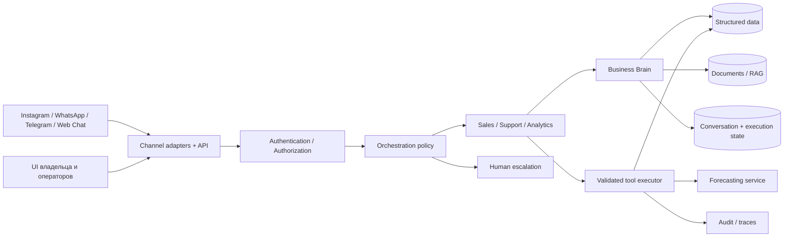

# Архитектура

## Общая схема

Схема описывает обязанности, а не отдельные сервисы. Бэкенд — модульный монолит на FastAPI, без микросервисов.

## Стек: что реально в коде

| Слой | Технология | Статус |
|---|---|---|
| Backend | Python 3.12, FastAPI, Pydantic | в коде |
| Данные | PostgreSQL + pgvector 0.8.1, RLS для изоляции арендаторов, Alembic 0001–0005, 26 таблиц | в коде |
| Кэш / объекты | Redis, MinIO (S3) | в коде |
| Идентификация | Keycloak, OIDC, JWT, RBAC | в коде |
| LLM | Gemini REST без SDK; Claude (с 05.11) | в коде |
| Оркестрация | LangGraph | **план**, M11; `orchestration/` содержит только `__init__.py` |
| Прогноз | pandas, scikit-learn, XGBoost | **план**, M13; кода нет |
| Frontend | Next.js 16 App Router, React 19, TypeScript, Tailwind 4, Vitest | в коде |
| Инфраструктура | Docker, Docker Compose | в коде; GitHub Actions не настроены |

## Карта кода

| Путь | Что там |
|---|---|
| `platform/services/backend/src/platform_backend/` | Пакет бэкенда |
| `…/api`, `…/security` | HTTP-слой и проверка токенов и членства в бизнесе |
| `…/domain`, `…/repositories`, `…/application` | Доменная модель и доступ к данным (M03) |
| `…/tools` | `contracts.py`, `executor.py`, `cursor.py`, `ports.py` — десять инструментов (M04) |
| `…/agents` | `runtime.py`, `provider.py`, `prompts.py`, `contracts.py` (M08); `ollama.py` — эксперимент, с PR #1 |
| `…/brain`, `…/rag`, `…/knowledge` | Business Brain и RAG (M06, M07) |
| `…/channels` | `whatsapp.py`, `inbox.py`, `routes.py`, `wiring.py` — демо-канал |
| `…/demo` | Посев демо-магазина North Shop |
| `…/observability` | Трассировка и аудит |
| `platform/infra/compose/` | `compose.yaml`, `compose.p5i.yaml` (OIDC/CORS), `compose.demo.yaml` (WhatsApp + Claude) |
| `platform/infra/{migrations,minio,model}` | Alembic, политика бакета MinIO, хэш модели эмбеддингов |
| `platform/tests/` | unit, integration, security, contract, reconstruction, experimental, p5i |
| `frontend/src/` | Маршруты `app/`, API-слой `services/api`, состояния `types/states.ts`, стили `styles/globals.css` |
| `docs/uml/` | 28 диаграмм PlantUML (все 14 типов UML 2.5 + ER), PNG и общий PDF |
| `research/master/release/` | `FINAL_MASTER_DEVELOPMENT_SAFE.pdf` — главный документ по приоритету |

## Принципы

- Авторизация и бизнес-инварианты — в детерминированных сервисах.
- Операционные факты берутся из структурированных источников; RAG — только для неструктурированных знаний.
- Контекст и происхождение данных сохраняются при передаче между агентами.
- Все три исследовательских варианта используют одни данные, проверки и инструменты.

## Источники

- [docs/ARCHITECTURE.md](https://github.com/Atilla888/multi-agent_for_sme/blob/main/docs/ARCHITECTURE.md) — статусы обновлены при чистке 15.11.2026
- [platform/docs/implementation/implementation_architecture_map.md](https://github.com/Atilla888/multi-agent_for_sme/blob/ffba5d2/platform/docs/implementation/implementation_architecture_map.md)
- [platform/docs/implementation/dependency_decisions.md](https://github.com/Atilla888/multi-agent_for_sme/blob/ffba5d2/platform/docs/implementation/dependency_decisions.md)
- [docs/uml/README.md](https://github.com/Atilla888/multi-agent_for_sme/blob/main/docs/uml/README.md)

Связи: [[02 Система/Агенты и инструменты]], [[02 Система/Business Brain и RAG]], [[02 Система/Фронтенд]].
