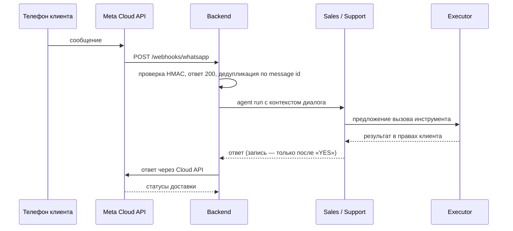

# Каналы и WhatsApp-демо

## Состояние каналов

| Канал | Состояние |
|---|---|
| WhatsApp | **Демо работает** с 05.11.2026, PR #8: тестовый номер Meta, ответы от агента на Claude |
| Web Chat (`/chat`) | Экран есть, транспорт не настроен |
| Instagram, Telegram | Не реализованы |

## Как устроено демо

- Код: `platform_backend/channels/` (`whatsapp.py`, `inbox.py`, `routes.py`, `wiring.py`) и `platform_backend/demo/`.
- Посев: магазин **North Shop** с товарами Desk Lamp, Work Chair, Wall Shelf; повторный запуск безопасен.
- Без всех `WHATSAPP_*` переменных вебхук отвечает 503.
- Если агент не может ответить по проверенным фактам, клиент получает «наша команда свяжется с вами», а диалог в Inbox помечается **Needs a person**.
- Повторы вебхуков от Meta не запускают агента дважды.

## Что нужно для показа

Аккаунт разработчика Meta и тестовый номер (до 5 подтверждённых телефонов), постоянный токен, ключ Anthropic API, `ngrok http 8000`, Docker Desktop. Inbox для сотрудников дополнительно требует realm Keycloak `p5i-engineering-*` — см. [[04 Работа/Локальный запуск#WhatsApp-демо]].

## Источники

- [docs/WHATSAPP_DEMO.md](https://github.com/Atilla888/multi-agent_for_sme/blob/main/docs/WHATSAPP_DEMO.md) — пошаговая инструкция и разбор неполадок
- [compose.demo.yaml](https://github.com/Atilla888/multi-agent_for_sme/blob/main/platform/infra/compose/compose.demo.yaml)

Связи: [[02 Система/Агенты и инструменты]], [[02 Система/Фронтенд]].
